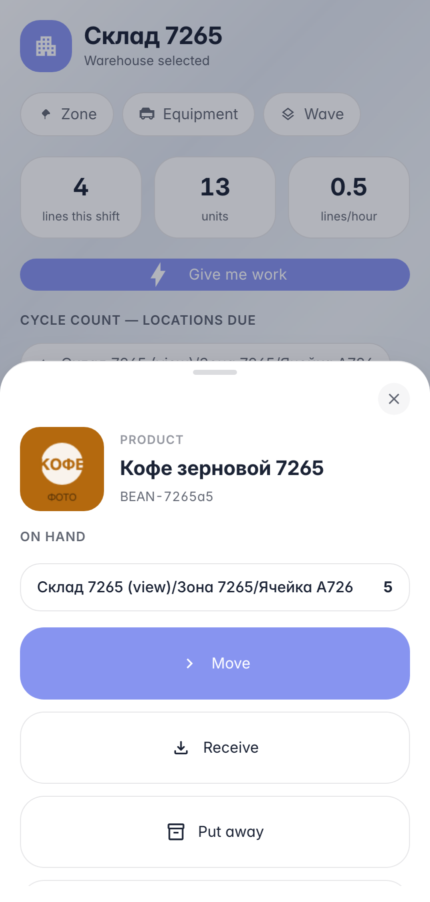
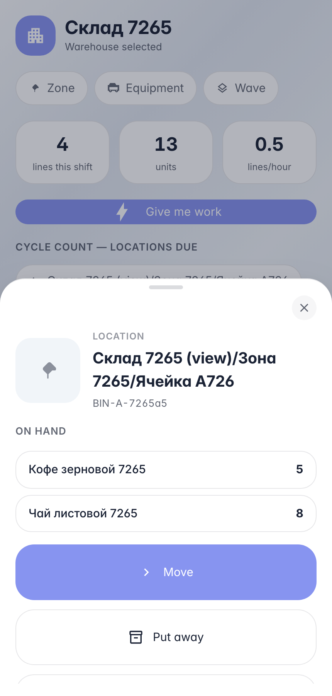
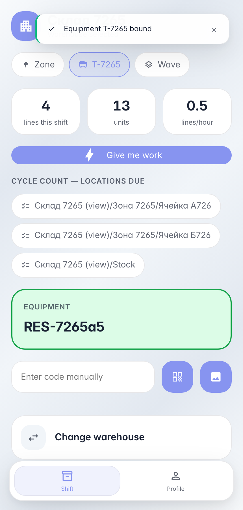

# Free inquiry: scan anything — entity card follows

**Purpose:** the operator can scan any barcode at any moment — regardless of the current screen: product, bin, container or equipment — the terminal shows its card with meaningful actions.

**Problems solved:** a rescan refreshes the open card in place instead of stacking windows; scanning a cart barcode offers binding it to the shift right from the card.

**Result:** three different scans swapped the contents of a single card; equipment bound without opening menus.

## Step 1. Product scan — card with stock

Free inquiry: scanning a product with no active task opens its card — photo, barcode, per-bin stock (loading asynchronously) and «receive / move / count» actions.

## Step 2. Bin scan — the card switched to its contents

The same sheet in place became the bin card: book contents «Coffee 5 + Tea 8». No window stack growth — the operator scans in a row, the terminal follows.

## Step 3. Equipment scan — bound to the shift from the card

**Result demonstration.** The cart barcode opened the resource card, «bind» claimed it for the operator on the server — the equipment chip now shows the cart code. No menus, no typing.

**Summary.** Any scan from any screen — the right card; a rescan refreshes it in place.

