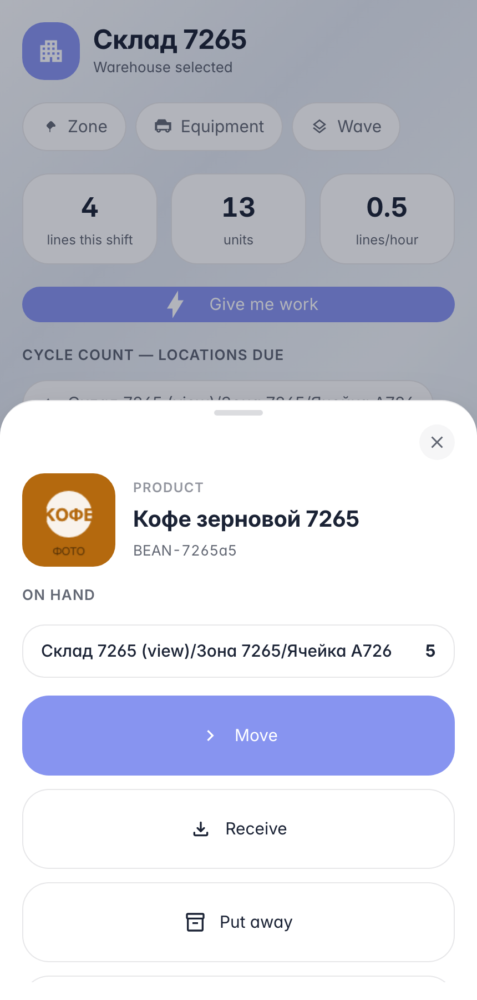
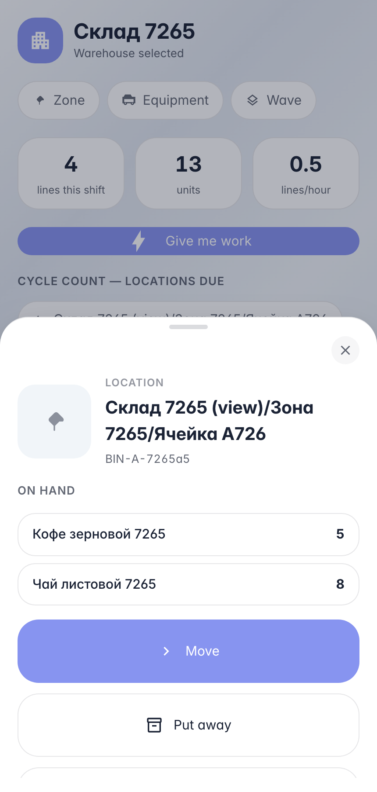
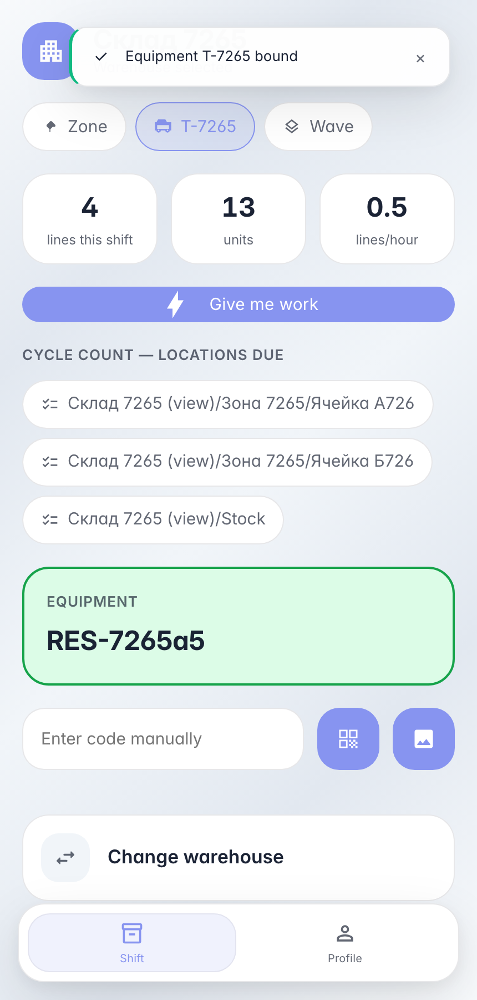

# Свободный осмотр: скан чего угодно — карточка сущности

**Для чего:** оператор может сканировать любой баркод в любой момент — не думая, на каком он экране: товар, ячейка, тара или техника — терминал показывает её карточку и осмысленные действия.

**Какие проблемы решает:** повторный скан обновляет открытую карточку по месту, а не плодит стек окон; скан баркида тележки предлагает привязать её к смене прямо из карточки.

**Результат:** три разных скана сменили содержимое одной карточки; техника привязана без входа в меню.

## Шаг 1. Скан товара — карточка с остатками

Свободный осмотр: скан товара без всякого задания открывает его карточку — фото, штрихкод, остатки по ячейкам (грузятся с лоудерами) и действия «принять / переместить / посчитать».

## Шаг 2. Скан ячейки — карточка переключилась на её содержимое

Тот же лист по месту стал карточкой ячейки: учётное содержимое «Кофе 5 + Чай 8». Стек окон не растёт — оператор сканирует подряд, терминал следует за рукой.

## Шаг 3. Скан техники — привязана к смене из карточки

**Демонстрация результата.** Штрихкод тележки открыл карточку ресурса, кнопка «привязать» закрепила её за оператором на сервере — чип техники теперь показывает код тележки. Никаких меню и ручного ввода.

**Итог.** Любой скан с любого экрана — правильная карточка; рескан обновляет её по месту.

