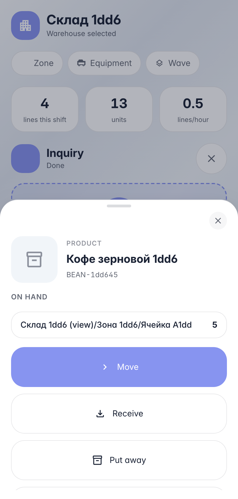
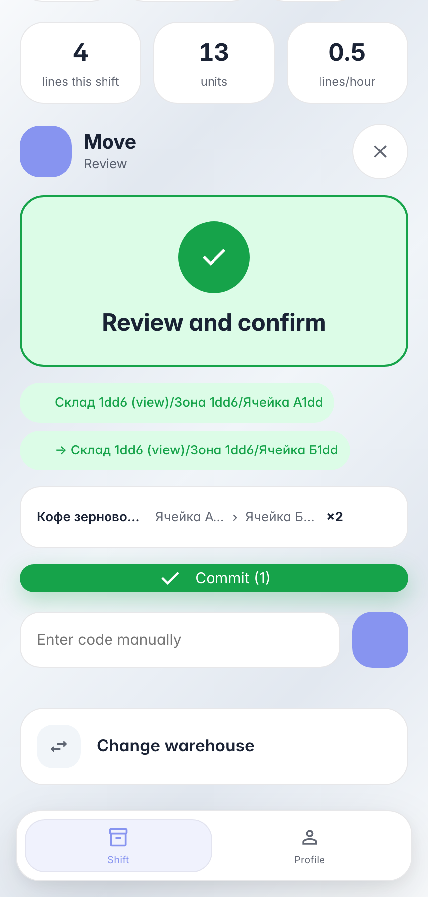

# Moving stock on the handheld: bin to bin

**Purpose:** replenishment and re-slotting — the operator moves stock between bins right at the rack, no desktop or paper trail.

**Problems solved:** the terminal walks the route «source → destination → quantity»; the product card shows current per-bin stock before the move starts.

**Result:** two products partially moved from bin A to bin B, stock updated instantly.

## Step 1. Scan a product — see where it sits

The product card answers «where to pick from» instantly: per-bin stock rows load asynchronously without blocking the scanner. «Move» starts a relocation — the product is already in the line.

## Step 2. Source → destination → quantity → commit

The move route is two bin scans and a digit: the terminal verifies both bins belong to the session warehouse and hold stock. The review line shows the «source → destination» route and quantity.

