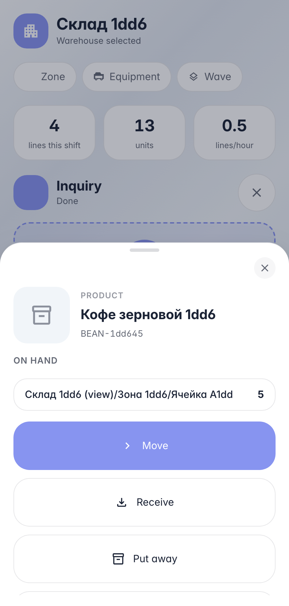
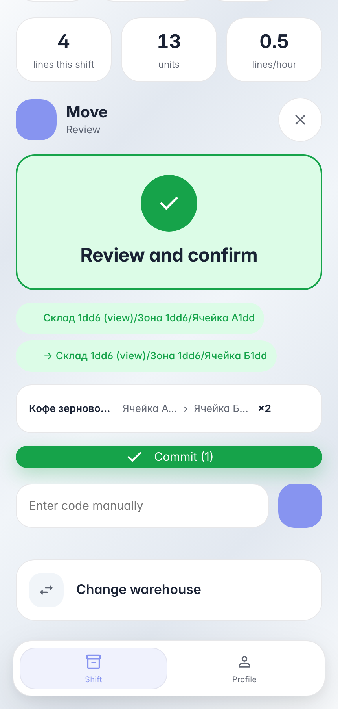

# Перемещение на терминале: товар из ячейки в ячейку

**Для чего:** переборка и пополнение — оператор переносит товар между ячейками прямо у стеллажа, без журнала и компьютера.

**Какие проблемы решает:** терминал ведёт по маршруту «источник → приёмник → количество», остатки на карточке товара видны до начала переноса.

**Результат:** два товара частично перемещены из ячейки А в ячейку Б, остатки обновлены мгновенно.

## Шаг 1. Отсканируйте товар — видно, где он лежит

Карточка товара сразу отвечает на вопрос «где брать»: строки остатков «ячейка → количество» подгружаются асинхронно, не блокируя сканер. Кнопка «Переместить» стартует перенос — товар уже подставлен в строку.

## Шаг 2. Источник → приёмник → количество → проводка

Маршрут переноса — два скана ячеек и цифра: терминал проверяет, что обе ячейки принадлежат складу сессии и хранят остаток. Строка review показывает направление «источник → приёмник» и количество.

