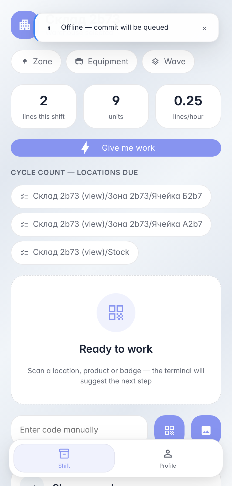

# Wi-Fi dead zone: the posting ships from the outbox

**Purpose:** metal racks kill connectivity — the operator must not stop or redo work: the commit lands in the outbox and ships itself when the network returns.

**Problems solved:** the idempotency key is written BEFORE the first attempt — a lost response cannot double post; the queue is FIFO, a domain rejection stops draining instead of silently skipping.

**Result:** a receipt entered offline shipped on reconnect, stock posted exactly once.

## Step 1. Offline commit queued in the outbox

Connectivity dropped between entry and posting — the terminal neither hung nor lost work: the document sits in the outbox with a ready idempotency key, the banner shows «pending: 1».

## Step 2. Back online — the document shipped exactly once

**Result demonstration.** The outbox is empty, the bin holds exactly 9 — no re-delivery: the key written before the first attempt prevented a duplicate.

**Summary.** Offline is not a stop sign: keep scanning, the terminal ships it itself.

