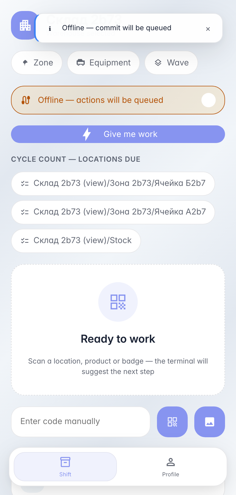
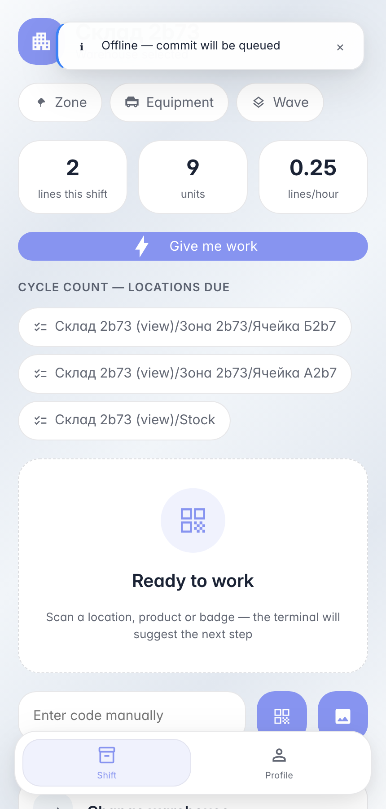

# Мёртвая зона Wi-Fi: проводка уедет из outbox при связи

**Для чего:** металлические стеллажи глушат связь — оператор не должен останавливаться или повторять работу: коммит встаёт в outbox и уезжает сам при возврате сети.

**Какие проблемы решает:** ключ идемпотентности пишется ДО первой попытки — потерянный ответ не даст двойной проводки; очередь FIFO, доменный отказ останавливает дрейн, а не молча пропускает.

**Результат:** приёмка набрана офлайн, уехала при восстановлении связи, остатки легли один раз.

## Шаг 1. Без связи коммит встал в outbox

Связь пропала между набором и проводкой — терминал не завис и не потерял работу: документ в outbox'е с готовым ключом идемпотентности, баннер показывает «ожидает отправки: 1».

## Шаг 2. Связь вернулась — документ доехал один раз

**Демонстрация результата.** Outbox пуст, на ячейке ровно 9 — повторной доставки не было: ключ, записанный до первой попытки, защитил от дубля.

**Итог.** Офлайн — не стоп-кран: набирай и сканируй, терминал дошлёт сам.

