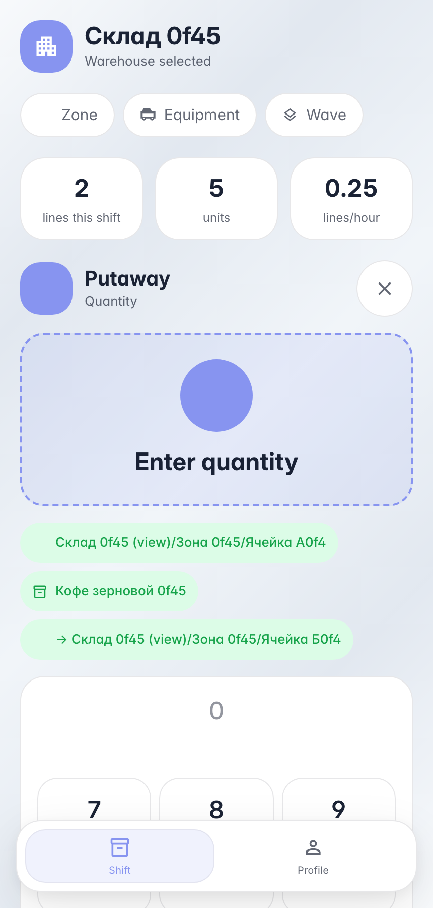

# Putaway: scan the product on staging → permanent bin

**Purpose:** received goods sit on staging — the operator takes them to a permanent bin.

**Problems solved:** scanning the product offers «Put away»: the terminal strictly guides — confirm the pick point, target bin with a placement hint, quantity. Source and destination cannot be mixed up.

**Result:** stock moved from staging to the storage bin as one internal operation.

## Step 1. Putaway captured — destination bin scanned

The «putaway» flow follows the physics: pick the product from staging → confirm the pick point → arrive at the target bin (the screen hints «where to put it») → enter quantity. Source and destination are separate scans — direction can't flip.

## Step 2. Scan the storage bin — the product is put away

**Result demonstration.** The bin card shows the stored coffee — putaway hit the ledger; staging is cleared.

**Summary.** Putaway against an order: scan document → product → staging → bin → qty → commit.

