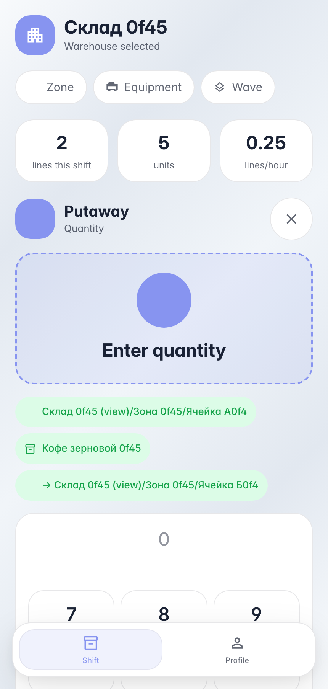

# Размещение: скан товара на стейдже → постоянная ячейка

**Для чего:** принятый товар стоит на стейдже — оператор увозит его в постоянную ячейку.

**Какие проблемы решает:** со скана товара открывается действие «Разместить»: терминал жёстко ведёт — подтверждение точки отбора, целевая ячейка с подсказкой «куда положить», количество. Перепутать источник и приёмник нельзя.

**Результат:** остаток переехал со стейджа в ячейку хранения одной внутренней операцией.

## Шаг 1. Размещение набрано — ячейка приёмник подтверждена сканом

Поток «размещение» ведёт по физике действия: взял товар со стейджа → подтвердил точку отбора → пришёл к целевой ячейке (экран показывает подсказку «куда положить») → ввёл количество. Источник и приёмник — разные сканы, перепутать направление нельзя.

## Шаг 2. Скан ячейки хранения — товар размещён

**Демонстрация результата.** Карточка ячейки показывает уложенный кофе — размещение записано леджером, стейдж разгружен.

**Итог.** Размещение по накладной: скан документа → товар → стейдж → ячейка → количество → проводка.

