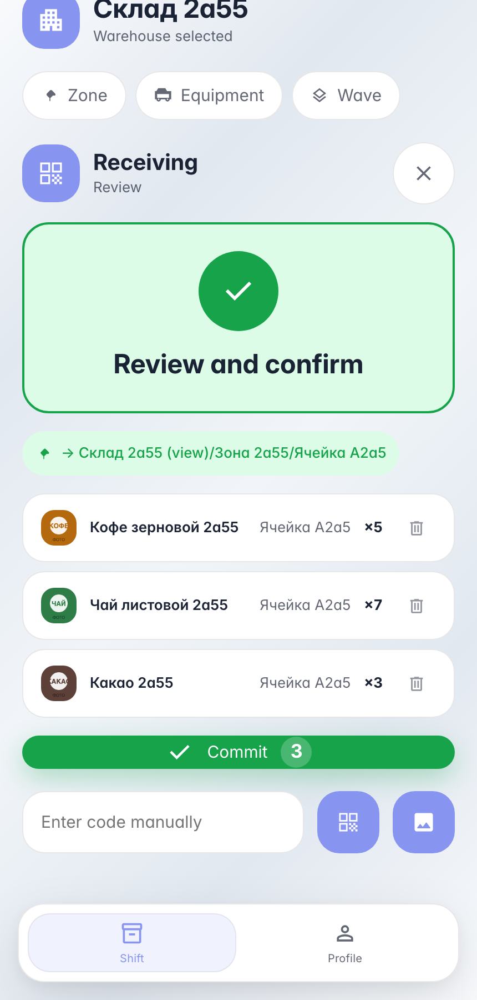

# Batch receiving: three products, one document

**Purpose:** a pallet carries several items — the operator enters lines back to back and posts a single receipt instead of three.

**Problems solved:** after quantity entry the terminal asks for the next product — the bin sticks between lines; review lists all entered positions before posting.

**Result:** three products posted in one document to one bin, stock landed in the ledger.

## Step 1. Three lines in review — one posting

After «5» for coffee the terminal waited for the next product. Tea scan → rescan the bin (where THIS product goes) → «7», cocoa scan → bin → «3»: three lines entered in a row. Posting goes as a single document.

## Step 2. Stock: three items on one bin

**Result demonstration.** The ledger confirms: coffee 5 + tea 7 + cocoa 3 sit on bin A — all posted by a single commit.

**Summary.** Batch receiving: product → bin → qty → next product → … → one commit.

