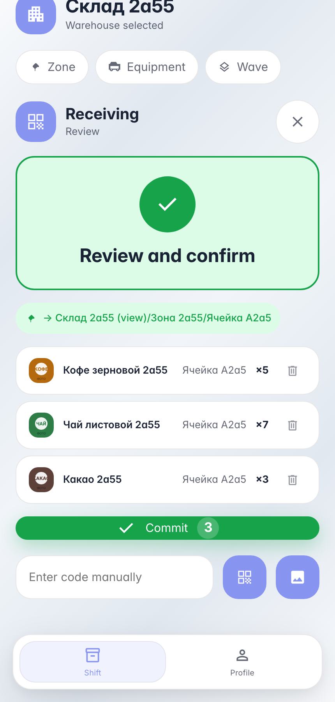
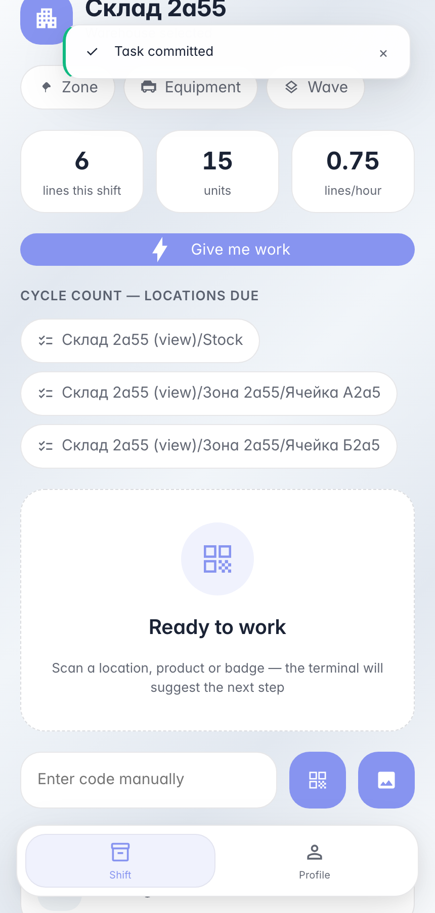

# Приёмка пачкой: три товара в один документ

**Для чего:** машина с паллетой везёт несколько позиций — оператор набирает строки подряд и проводит одну приёмку, а не три отдельные.

**Какие проблемы решает:** после ввода количества терминал снова ждёт товар — ячейка удерживается между строками; review показывает все набранные позиции перед проводкой.

**Результат:** три товара проведены одним документом на одну ячейку, остатки легли по леджеру.

## Шаг 1. Три строки в review — одна проводка

После «5» по кофе терминал ждал следующий товар. Скан чая → повторный скан ячейки (куда кладём ЭТОТ товар) → «7», скан какао → ячейка → «3»: три строки набраны подряд. Проводка пойдёт одним документом.

## Шаг 2. Остатки: три позиции на одной ячейке

**Демонстрация результата.** Леджер подтверждает: кофе 5 + чай 7 + какао 3 лежат на ячейке А — все пришли единственной проводкой.

**Итог.** Приёмка пачкой: товар → ячейка → количество → следующий товар → … → один commit.

