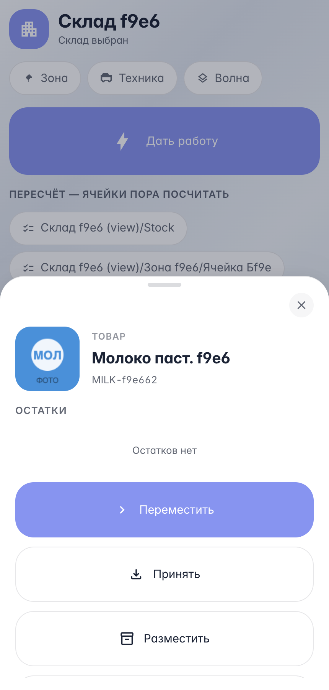
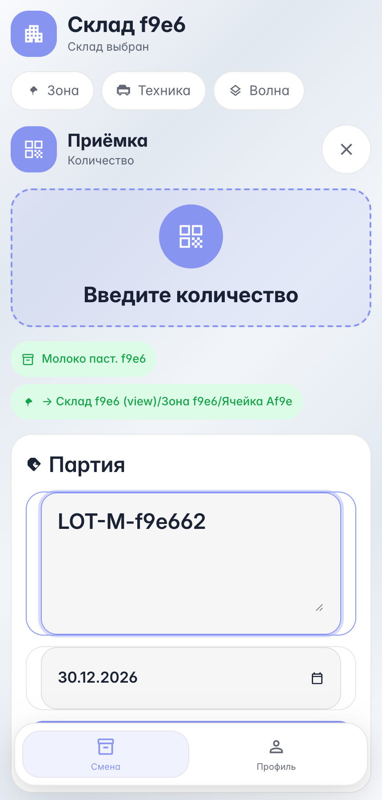
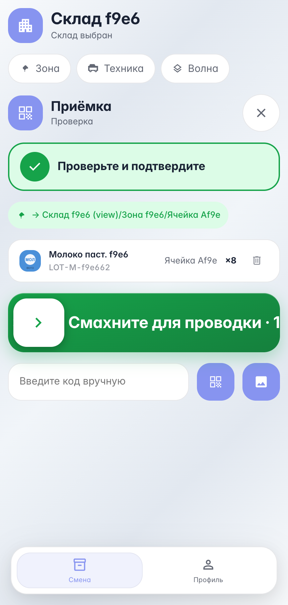
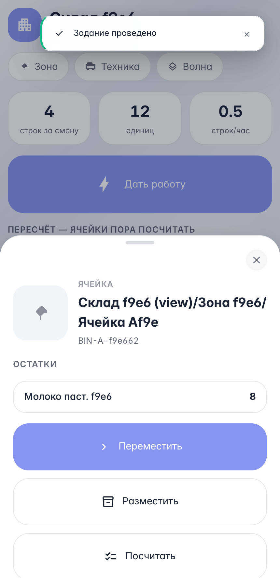

# Приёмка партийного товара: номер партии и срок годности

**Для чего:** продукты, лекарства и косметику складам принято вести партиями — каждая поставка имеет свой номер и «годен до». Без этого нельзя понять, что просрочено, и отгружать старое раньше нового.

**Какие проблемы решает:** терминал сам просит номер партии и срок годности ровно в тот момент, когда они нужны — после скана ячейки, до количества. Если на упаковке есть только бумажная этикетка, данные вводятся руками в два коротких поля.

**Результат:** два партийных товара приняты каждый в свою партию, сроки годности записаны, партии видны в справочнике и на остатках.

## Шаг 1. Отсканируйте партийный товар

Карточка партийного товара выглядит как у обычного — фото и остатки по ячейкам. «Принять» стартует сессию приёмки, разница появится на шаге количества: терминал попросит партию.

## Шаг 2. Введите номер партии и «годен до»

Вместо клавиатуры цифр — компактная панель партии: номер с бумажной этикетки и дата «годен до». Если на упаковке напечатан GS1-код — сканируйте его, оба поля заполнятся сами.

## Шаг 3. Проверьте строку приёмки

Строка исполнения показывает товар и введённую партию рядом с количеством — до проводки видно, что именно уложится на остаток и с каким номером партии.

## Шаг 4. Отсканируйте ячейку — остаток принят по партии

**Демонстрация результата.** Ячейка показывает принятое количество, а справочник партий (раздел «Партии» на компьютере) — обе новые партии со сроками «годен до»: по ним система отберёт сначала то, что испортится раньше.

**Итог.** Приёмка партийного товара: скан товара → ячейка → номер партии и «годен до» → количество → проводка. Партии заводятся на лету, повторный номер находит уже существующую.

