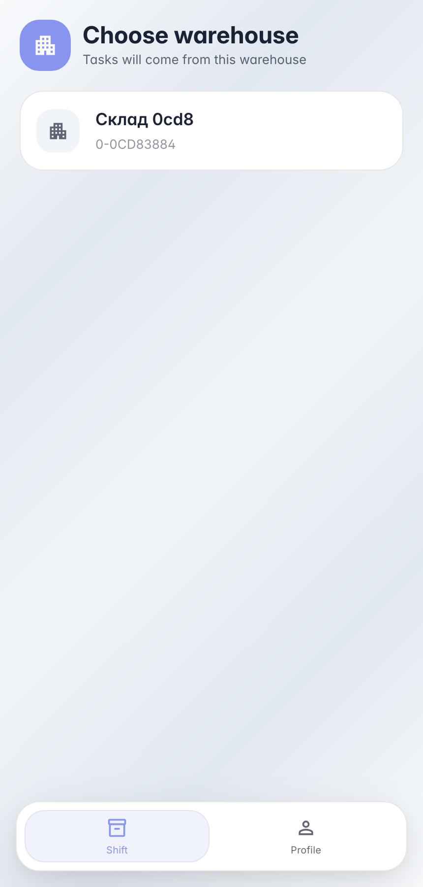
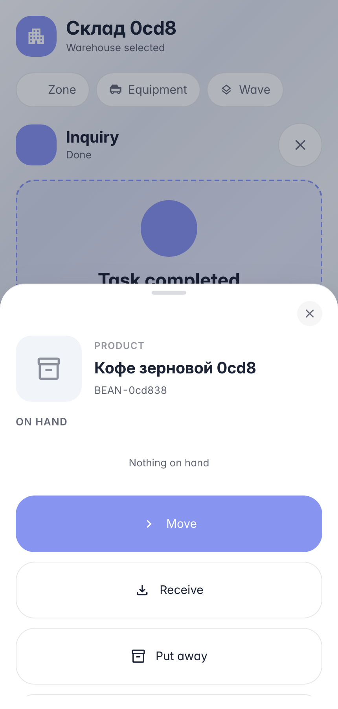
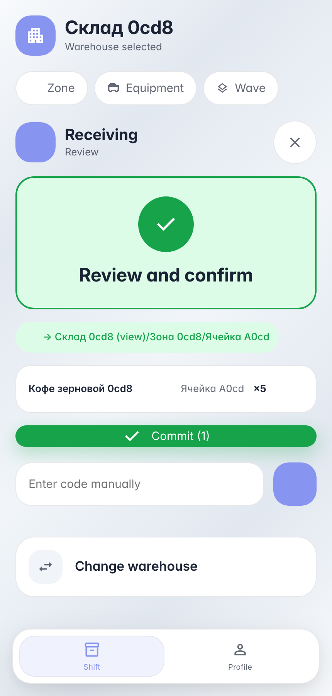
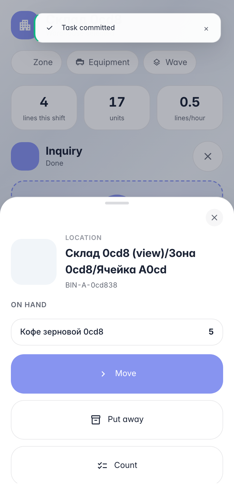

# Receiving on the handheld: product scan, bin scan, commit

**Purpose:** daily warehouse operator work — receive a delivery on a handheld or phone without a desktop or paper documents.

**Problems solved:** the terminal guides the operator — the screen tells what to scan next; scanning any product opens its card with stock and actions.

**Result:** two products received into warehouse bins, stock visible right on the terminal.

## Step 1. Pick the warehouse on the handheld

The terminal opens with a company warehouse list — the operator picks theirs once per shift. Large cards are easy to tap with gloves on.

## Step 2. Scan a product — its card opens

Scanning any barcode on the work screen opens an entity card: a product shows name, photo and per-bin stock (loaded asynchronously), a bin shows its contents, a document opens execution. Product card actions: receive, move, count.

## Step 3. Receiving: bin and quantity scans

«Receive» from the product card starts a receiving session — the product is already filled in, the terminal asks for a bin. Scan the bin, enter quantity on the numpad — the line is ready to commit.

## Step 4. Scan a bin — see its contents

**Result demonstration.** Scanning a bin shows its physical contents: products and quantities just received on the terminal. From here — moving and counting the bin in one tap.

**Summary.** Receiving on the handheld: scan product → «Receive» → scan bin → quantity → commit; stock is immediately visible in the bin card.

