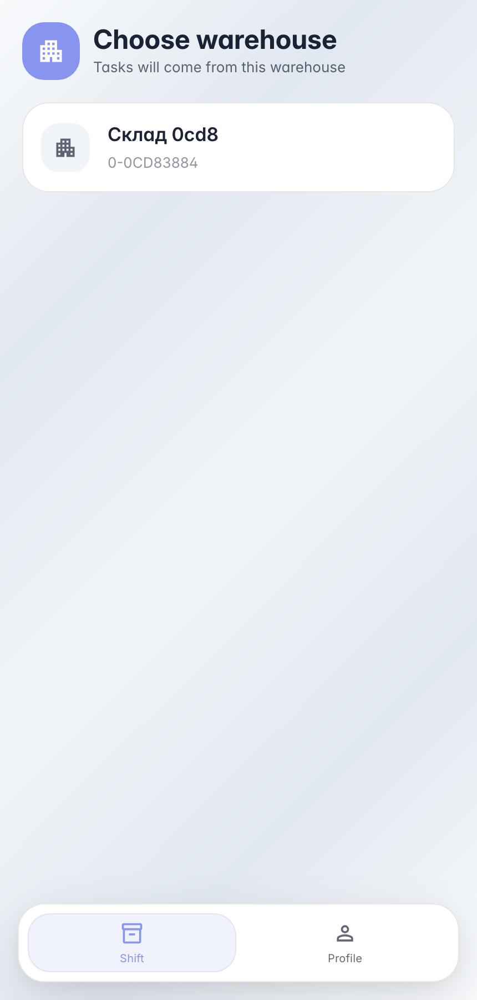
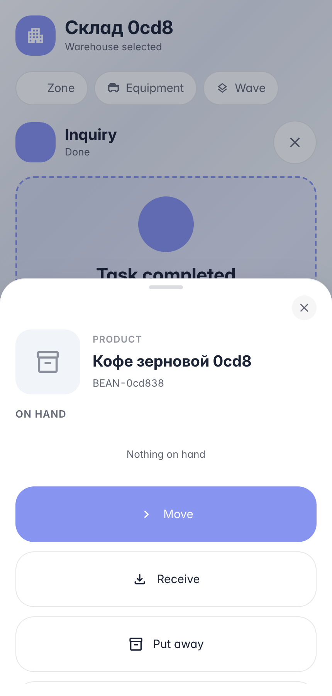
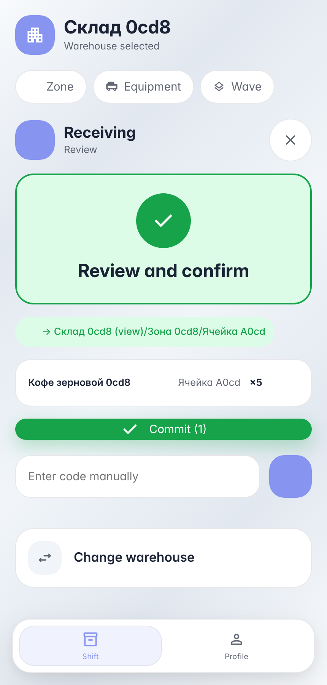
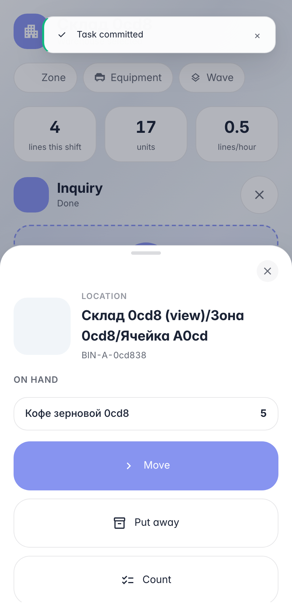

# Приёмка на терминале: скан товара, ячейки и проводка

**Для чего:** повседневная работа оператора склада — принять поставку на ТСД/телефоне без компьютера и бумажных накладных.

**Какие проблемы решает:** терминал сам ведёт по шагам — что сканировать дальше подсказывает экран; скан любого товара показывает его карточку с остатками и действиями.

**Результат:** два товара приняты в ячейки склада, остатки видны прямо на терминале.

## Шаг 1. Выберите склад на терминале

Терминал открывается списком складов компании — оператор выбирает свой один раз за смену. Крупные карточки удобно жать в перчатках.

## Шаг 2. Отсканируйте товар — откроется его карточка

Скан любого штрихкода на рабочем столе открывает карточку сущности: у товара — название, фото и остатки по ячейкам (подгружаются асинхронно), у ячейки — содержимое, у накладной — вход в исполнение. Из карточки товара доступны действия: принять, переместить, посчитать.

## Шаг 3. Приёмка: скан ячейки и количества

«Принять» из карточки товара стартует сессию приёмки — товар уже подставлен, терминал просит ячейку. Скан ячейки, количество на экранной клавиатуре — строка готова к проводке.

## Шаг 4. Отсканируйте ячейку — видно её содержимое

**Демонстрация результата.** Скан ячейки показывает физическое содержимое: товары и количества, только что принятые терминалом. Отсюда же — перемещение и инвентаризация ячейки в один жест.

**Итог.** Приёмка на терминале: скан товара → «Принять» → скан ячейки → количество → проводка; остатки видны сразу в карточке ячейки.

