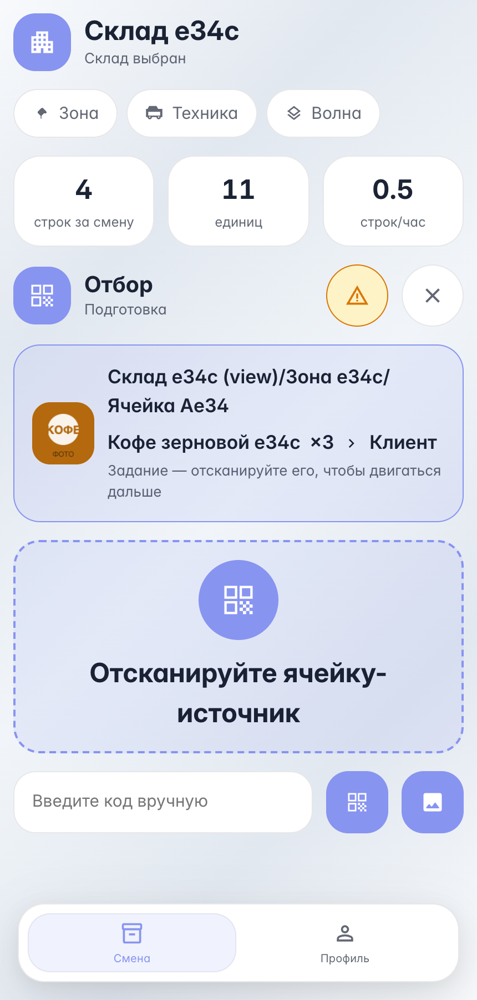
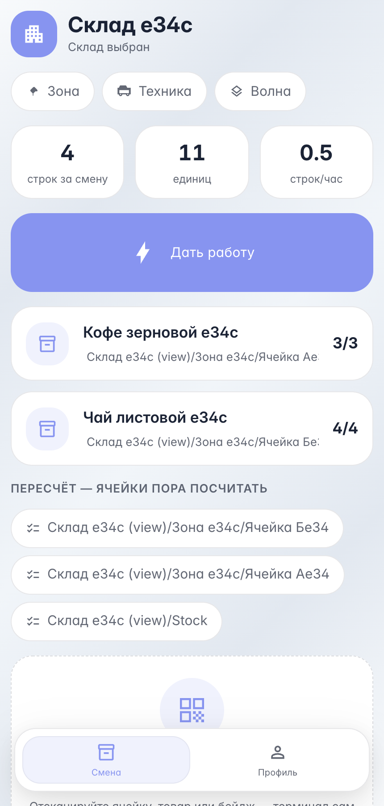
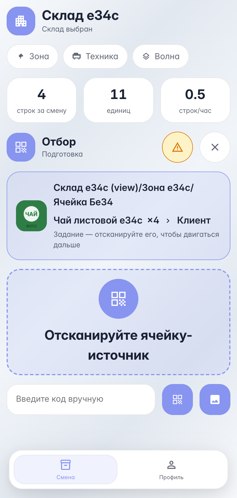
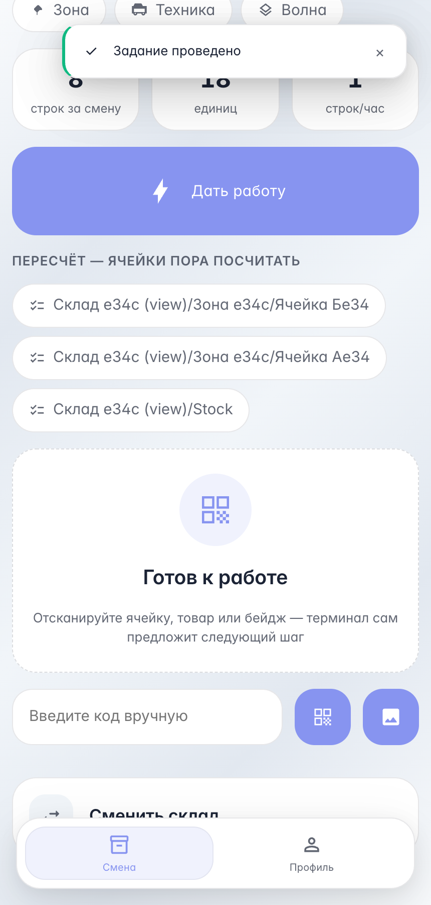

# Switching between tasks: exit returns the line to the queue

**Purpose:** the operator knows the physical walk order best — claimed a task, reached the bin and realised another line is closer. The terminal must release the first one cleanly.

**Problems solved:** leaving a run returns the line claim to the shared queue instantly — colleagues do not wait for GC, the operator hand-picks the nearest work.

**Result:** both order lines posted in the operator's preferred order — the document closed.

## Step 1. «Give me work» issued the coffee line — claimed

The first line is claimed by the operator: while they are in the run, colleagues do not see it. But the operator is already at bin B — the tea is closer.

## Step 2. Close — the line is free for everyone instantly

Exiting the run released the claim ahead of any GC timers: the coffee line is back in the shared queue — a colleague can see it too. The operator taps the tea card for the nearest work.

## Step 3. Second line opened — work switched

Tapping the card claimed the tea line and opened the run — no menus, no extra confirmations. Physically the operator picks whatever is closest.

## Step 4. Order closed in the operator's own order

**Result demonstration.** The tea was posted first — physically closer; the coffee was finished after returning via «give me work». Stock matched: bin B 6 → 2, bin A 5 → 2.

**Summary.** Closing a run is a clean switch: the claim returns to the queue instantly, and the walk order is the operator's call.

