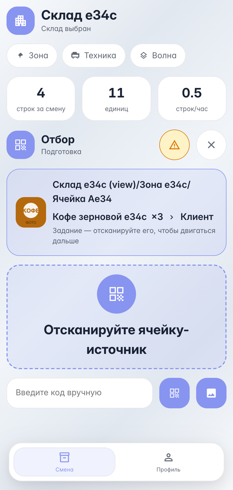
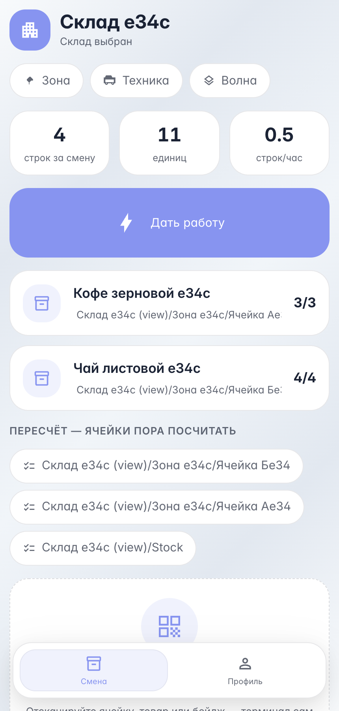
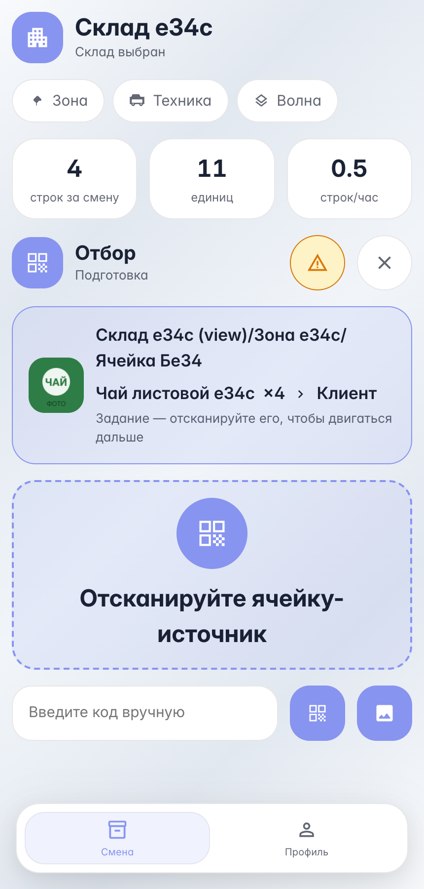
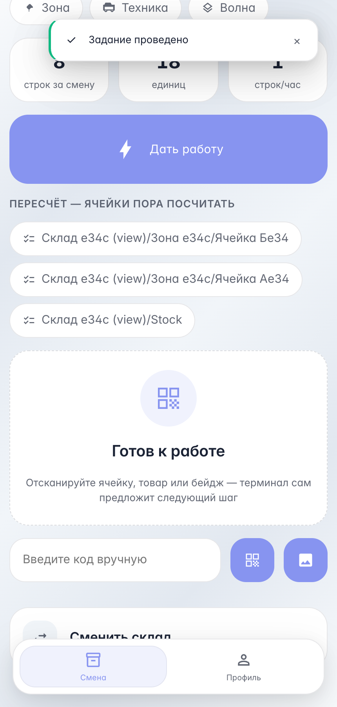

# Переключение между заданиями: вышел — строка вернулась в очередь

**Для чего:** оператор физически лучше знает порядок обхода — взял задание, дошёл до ячейки и понял, что другая строка лижет рядом. Терминал должен отпустить первую без конфликтов.

**Какие проблемы решает:** выход из прогона возвращает захват строки в общую очередь мгновенно — коллега не ждёт GC, оператор берёт ближнюю работу руками.

**Результат:** обе строки накладной проведены в удобном оператору порядке — документ закрыт.

## Шаг 1. «Дать работу» выдало строку кофе — она захвачена

Первая строка захвачена за оператором: пока он в прогоне, коллеги эту строку не видят. Но оператор уже у ячейки Б — ему ближе чай.

## Шаг 2. Крест — строка мгновенно свободна для всех

Выход из прогона отпустил захват до любых GC-таймеров: строка кофе снова в общей очереди — её увидит и коллега. Оператор берёт ближнюю работу тапом по карточке чая.

## Шаг 3. Вторая строка открыта — работа переключена

Тап по карточке захватил строку чая и открыл прогон — без выхода в меню и лишних подтверждений. Физически оператор добирает то, что рядом.

## Шаг 4. Накладная закрыта в удобном оператору порядке

**Демонстрация результата.** Чай проведён первым — физически ближе; кофе добран после возврата через «дайте работу». Остатки сошлись: ячейка Б 6 → 2, ячейка А 5 → 2.

**Итог.** Крест из прогона — честное переключение: захват возвращается очереди сразу, порядок обхода решает оператор.

