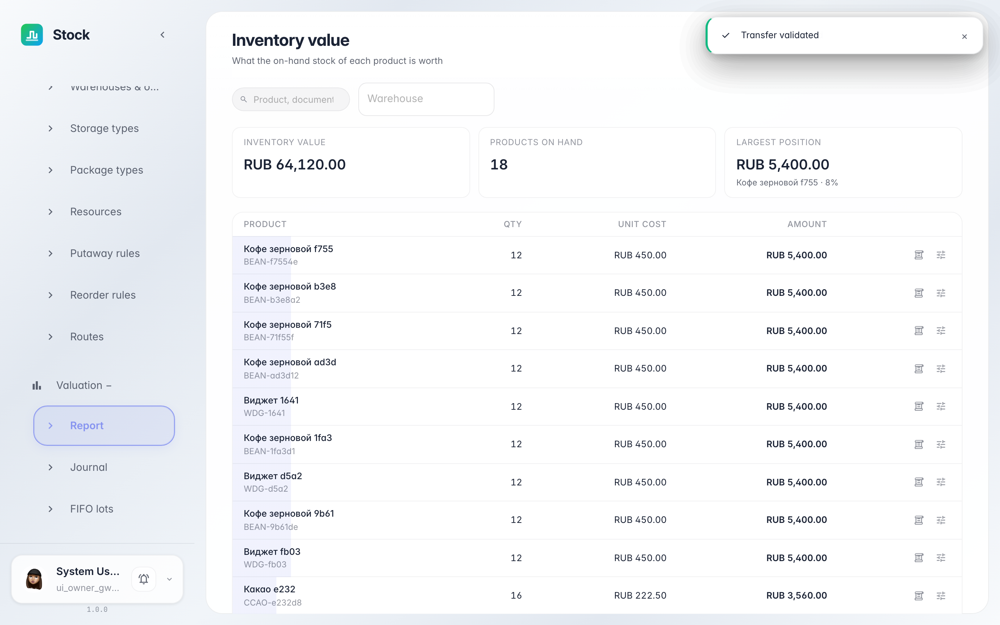
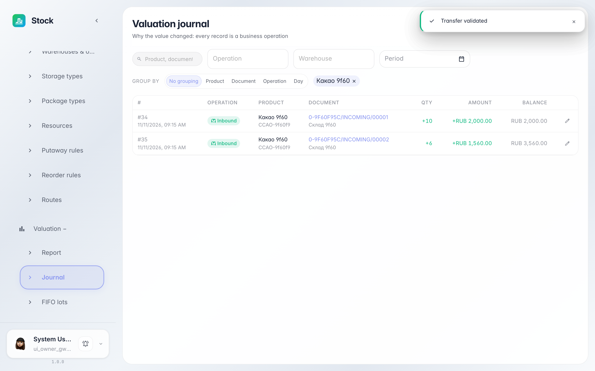

# Stock valuation: what the warehouse is worth

**Purpose:** «Valuation» shows stock in money terms: every receipt writes a layer with quantity and price, and issues consume layers in the product's valuation order.

**Problems solved:** you will learn where to find the value of on-hand stock, where the accounting price comes from and why two receipts at different prices are two separate layers.

**Result:** the valuation journal shows inbound layers with prices — the warehouse's value is transparent.

## Step 1. Open Valuation report

Expand «Valuation» in the left menu and choose «Report». Each product's on-hand stock is shown in money: the cocoa position is worth 3560 (10 units at 200 + 6 at 260, exactly as in the receipts). The summary above answers how much the warehouse is worth in total.

## Step 2. Product journal

Clicking a report row opens the product's journal: two «Inbound» records — 10 units at 200 and 6 at 260 — each linked to its receipt. When goods leave, layers are consumed in the valuation order (fifo takes the earliest receipt first), so the delivery's cost of goods always comes from real prices.

**Summary.** Valuation is the warehouse's cost ledger: the report answers how much money is on the shelves, the journal explains why.

