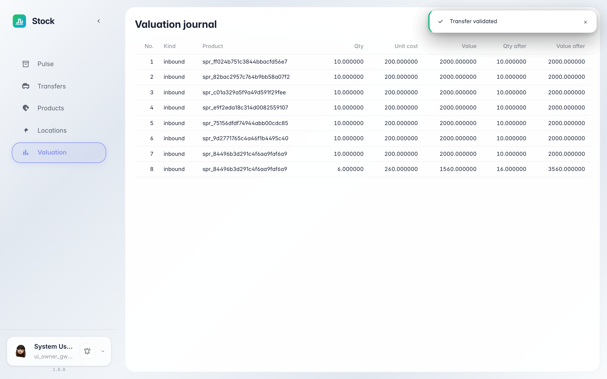

# Оценка запасов: во сколько обходится склад

**Для чего:** «Оценка» показывает запасы в деньгах: каждый приход записывает слой с количеством и ценой, списания забирают слои по методу оценки товара.

**Какие проблемы решает:** вы увидите, где искать стоимость остатков, откуда берётся цена в учёте и почему два прихода по разной цене — это два разных слоя.

**Результат:** в журнале оценки видны слои прихода с ценами — стоимость склада прозрачна.

## Шаг 1. Откройте «Оценку»

В меню слева выберите «Оценку». Каждая проведённая приёмка записала стоимостной слой: у одного товара две строки — 10 шт. по 200 и 6 шт. по 260, как в документах. Тип «inbound» показывает, что слой пришёл с поступлением.

## Шаг 2. Как это читать

**Демонстрация результата.** Стоимость склада — сумма живых слоёв: 10×200 + 6×260 = 3560 по этому товару. Когда товар уходит, слои списываются в порядке метода оценки (для fifo — сначала более ранний приход), поэтому себестоимость отгрузки всегда посчитана из реальных цен, а не «в среднем».

**Итог.** Оценка — это стоимостной леджер склада: отсюда видно, во сколько обошёлся каждый приход и сколько денег сейчас лежит на полках.

