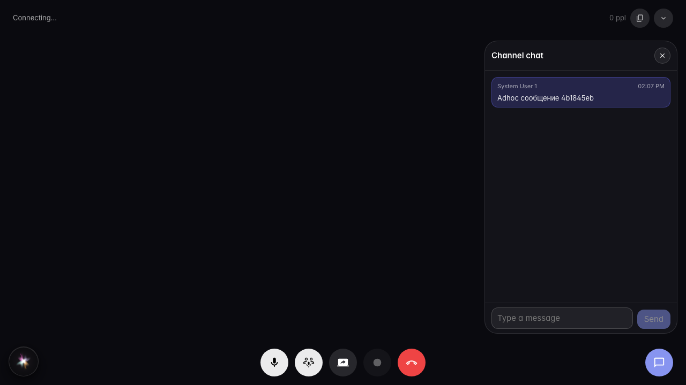
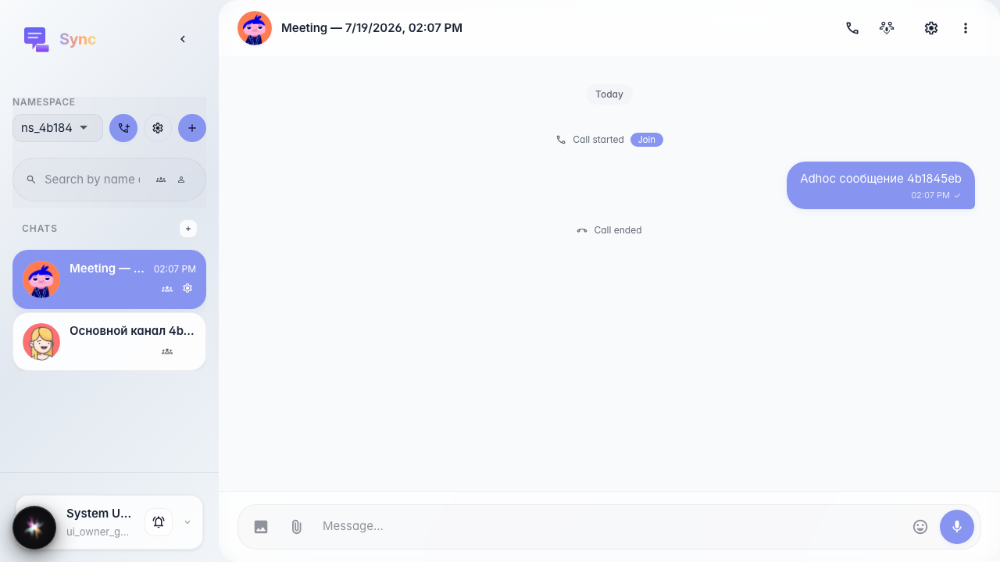

# Sync: ad-hoc call uses a normal visible channel

The «Create Sync» button creates a meeting channel with a readable name (date and time), chat works in the overlay, and after switching channels the meeting messages remain in that channel.

## Step 1. Ad-hoc meeting created a visible channel named by date and time

## Step 2. After switching channels, ad-hoc channel messages are preserved

