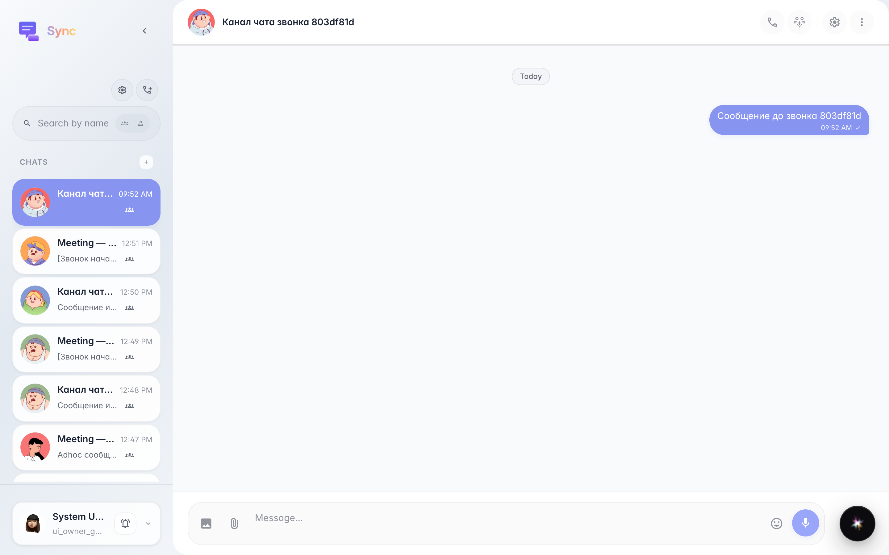
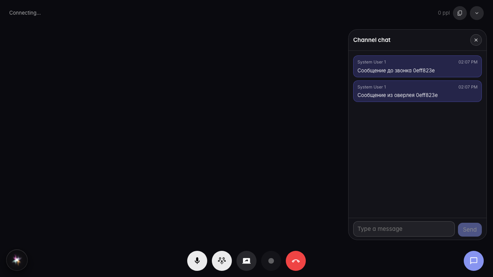
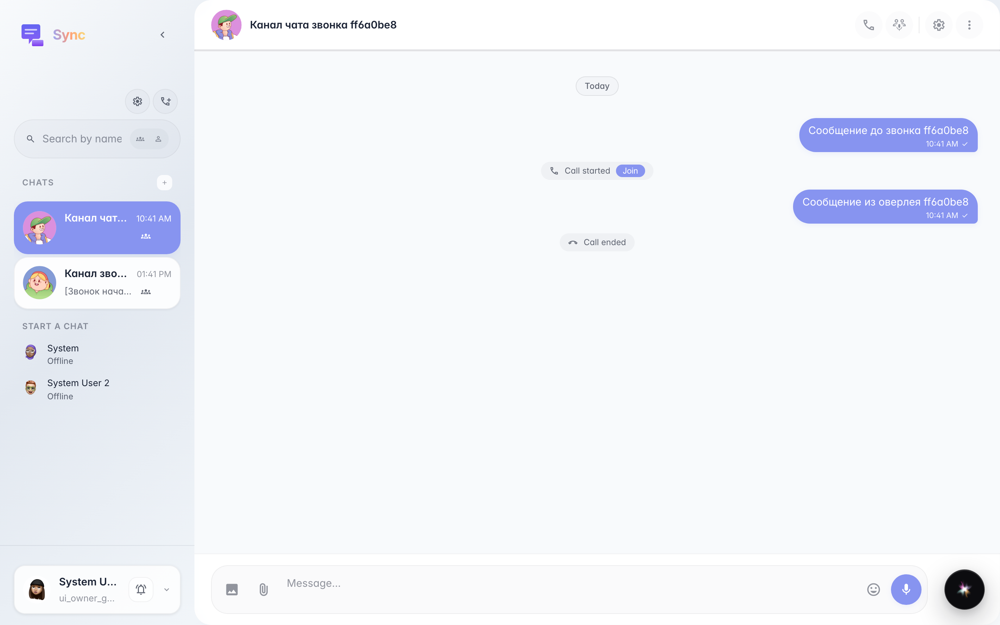

# Sync: call overlay chat stays in sync with the channel

A message from the main chat appears in the call overlay, and a message from the call overlay appears in the channel feed after the call ends.

## Step 1. Message sent from the main chat

## Step 2. Call overlay chat accepts and sends messages

## Step 3. Message from the overlay is visible in the main channel chat

