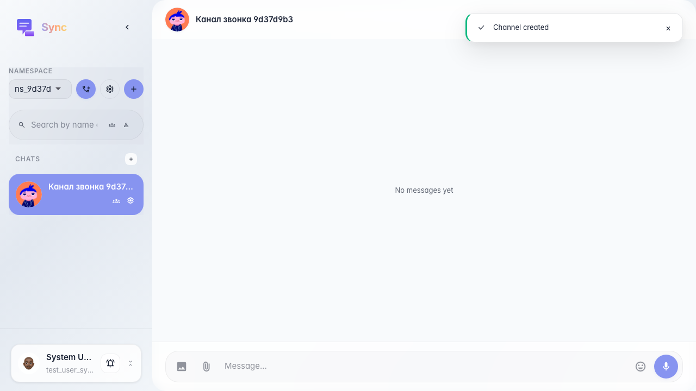
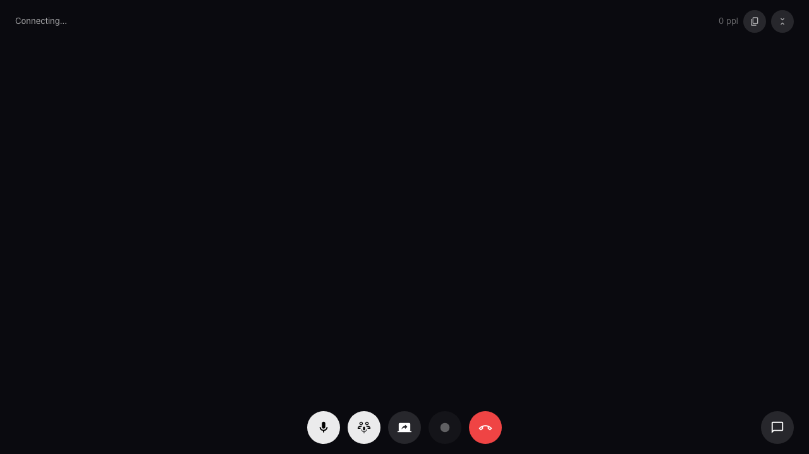

# Sync: start a call from the channel header

In a topic channel the user clicks «Call in this channel»; after the server responds the call overlay appears (data-call-active on sync-app).

## Step 1. Topic channel opened

## Step 2. Call overlay is displayed

