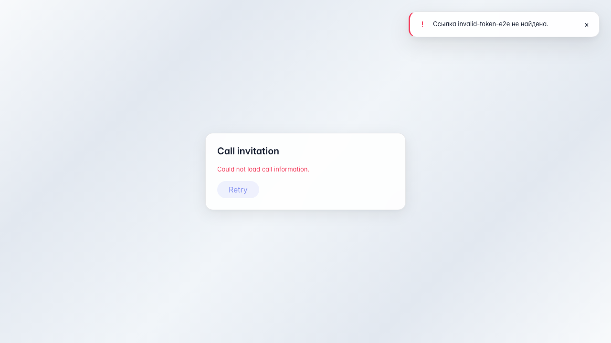

# Sync: join page for an invalid link

The public /sync/join/{token} page shows an error message for a nonexistent token.

## Step 1. Call join page opened from link

## Step 2. Error message for invalid join link

