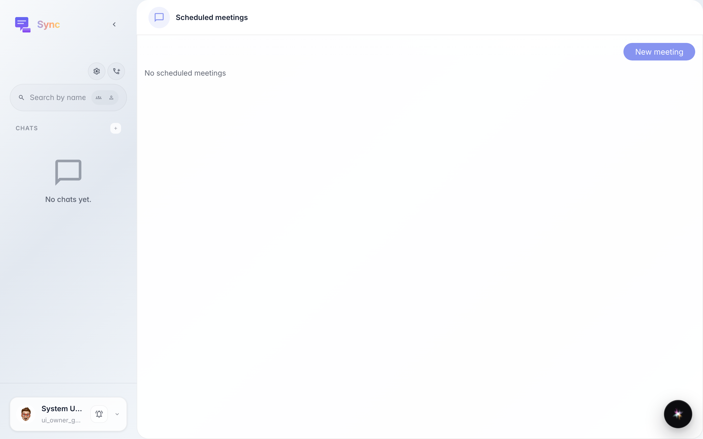
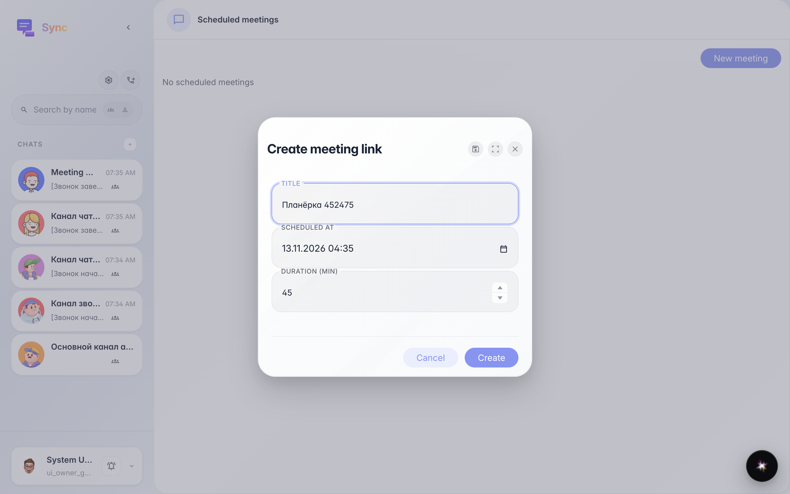
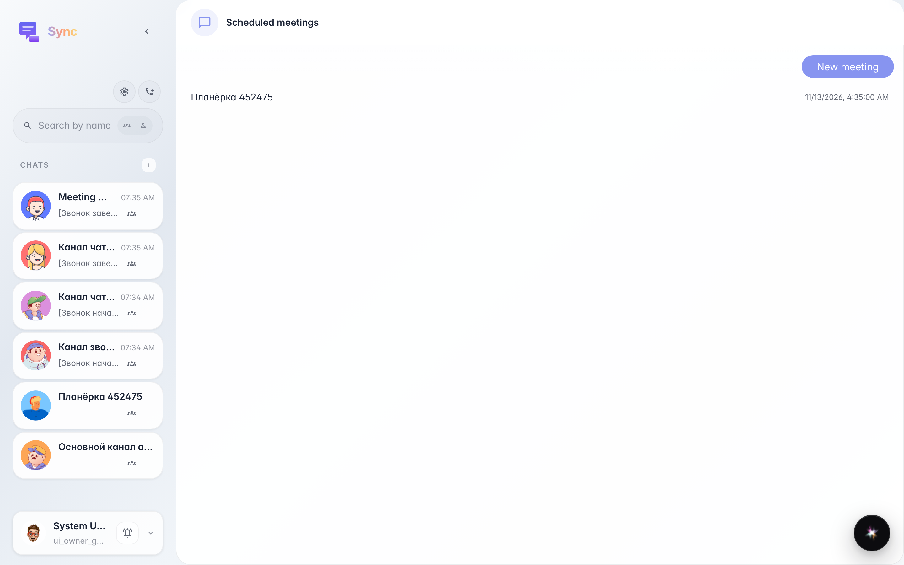
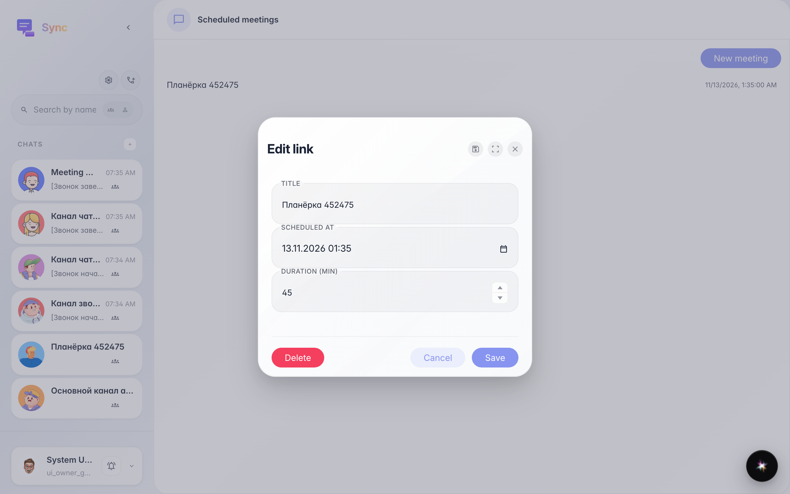

# Sync: scheduled meeting with a guest link

**What for:** this guide shows how to schedule a meeting in advance and get a link your guests will use to join.

**Problems it solves:** without a link guests don't know where to go, and the meetings list keeps your scheduled calls in one place.

**Result:** the meeting is created, visible in Scheduled meetings, and can be opened for editing.

## Step 1. Open Scheduled meetings

Open the meetings list from the mobile bottom navigation or via Calls → Scheduled. The list is empty until you create a meeting.

## Step 2. Fill in title, date and duration

Click Create meeting, enter a title, pick the date and time, and adjust the duration in minutes if needed.

## Step 3. Meeting appears in the list

Once created, the meeting appears in the list with its date. Share the link with guests — they can join without an account.

## Step 4. Open the meeting for editing

Click a meeting in the list to open its settings: rename it, move the time, or delete the link.

