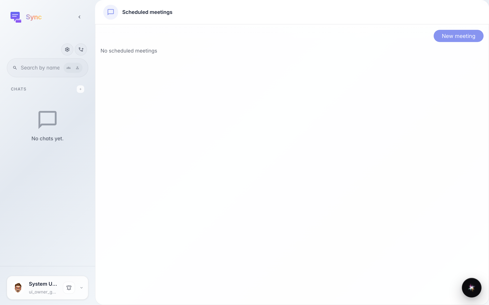
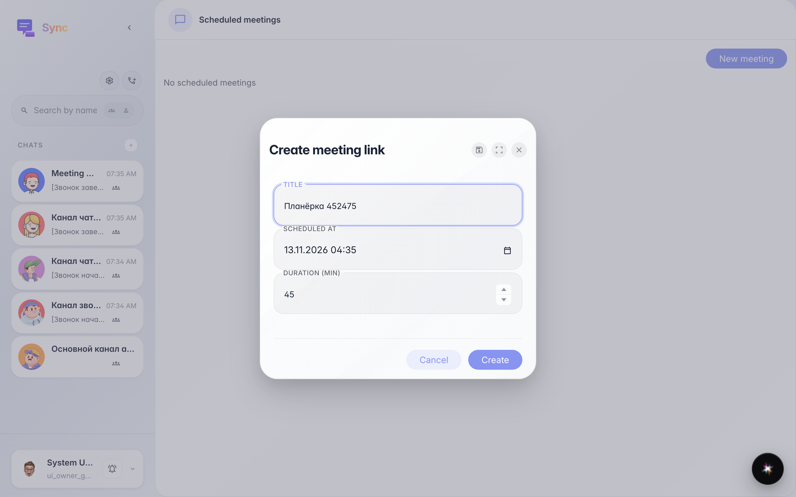
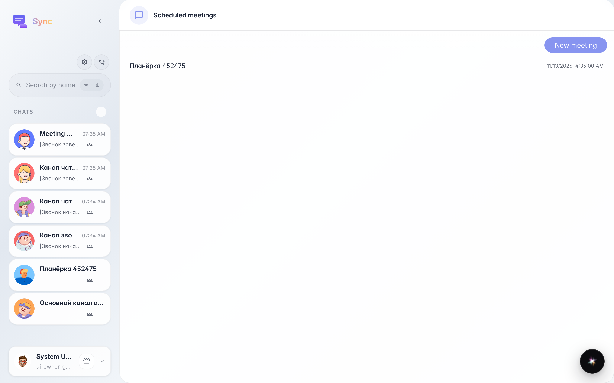
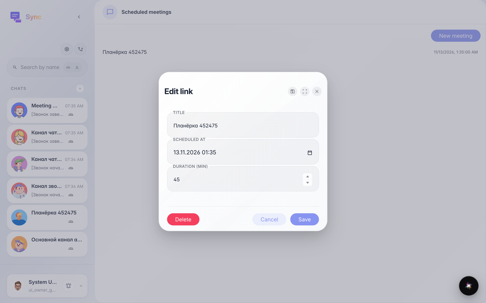

# Sync: встреча по расписанию с гостевой ссылкой

**Для чего:** эта инструкция покажет, как запланировать встречу заранее и получить ссылку, по которой подключатся участники.

**Какие проблемы решает:** без ссылки гости не знают, куда заходить, а список встреч помогает не потерять запланированный звонок.

**Результат:** встреча создана и видна в списке «Запланированные встречи», её можно открыть и изменить.

## Шаг 1. Откройте «Запланированные встречи»

В мобильной нижней навигации или по адресу «Звонки → Запланированные» откройте список встреч. Пока встреч нет — список пуст.

## Шаг 2. Заполните название, дату и длительность

Нажмите «Создать встречу», введите название, выберите дату и время и при необходимости измените длительность в минутах.

## Шаг 3. Встреча появилась в списке

После создания встреча сразу видна в списке с датой проведения. Ссылку можно отправить гостям — они подключатся без аккаунта.

## Шаг 4. Откройте встречу для редактирования

Нажмите на встречу в списке — откроются её настройки: можно переименовать, перенести время или удалить ссылку.

