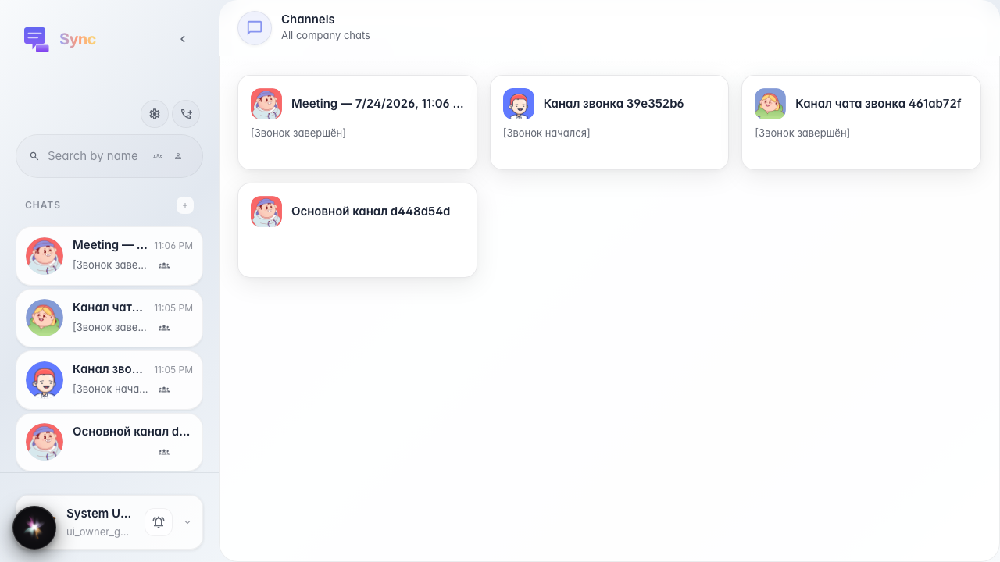
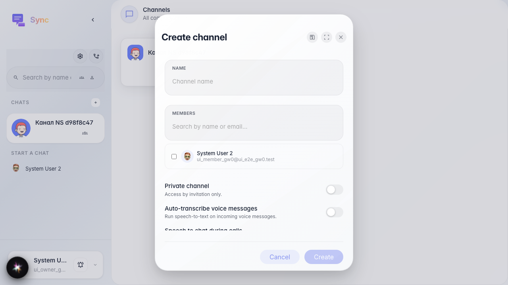
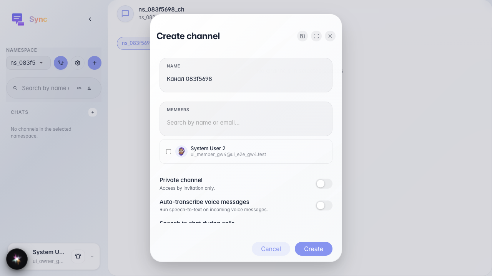
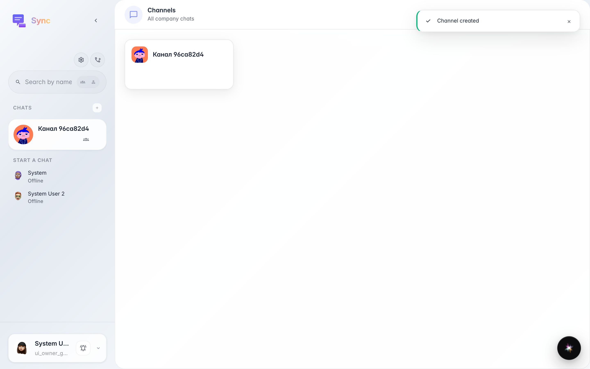

# Sync: create a channel in a space

After creating a space the user creates a topic channel via «+» next to «Channels» and confirms creation.

## Step 1. Sync space selected

## Step 2. Channel creation opened

## Step 3. Channel name entered

## Step 4. Channel appeared in the sidebar

