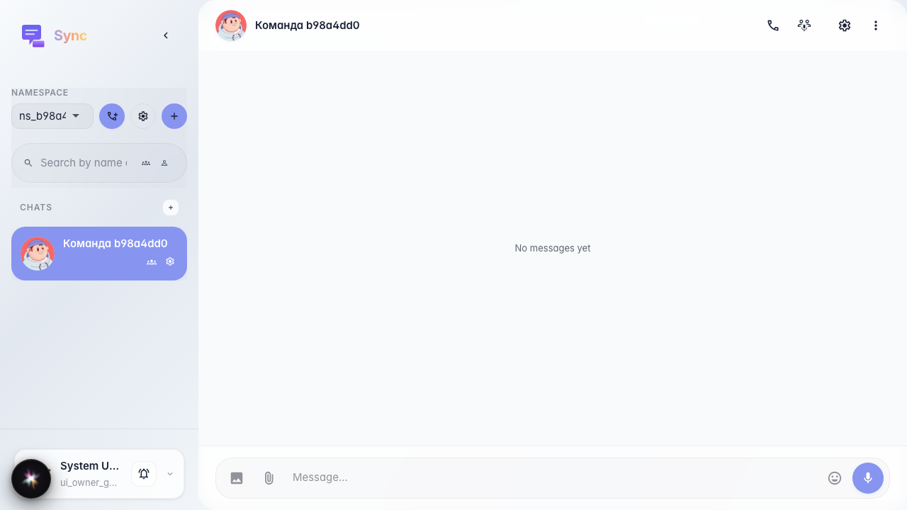
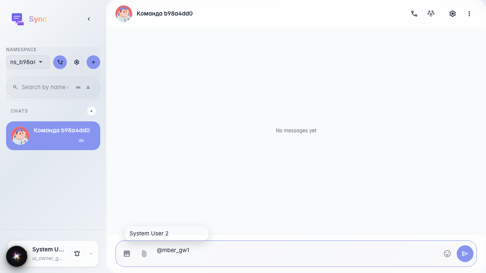
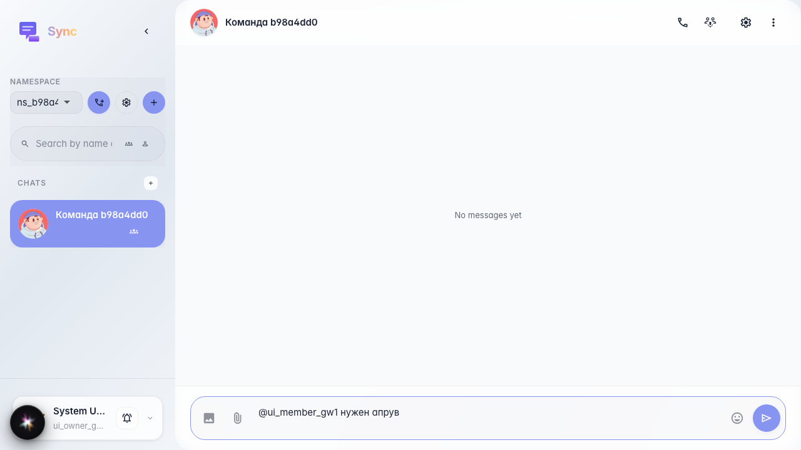
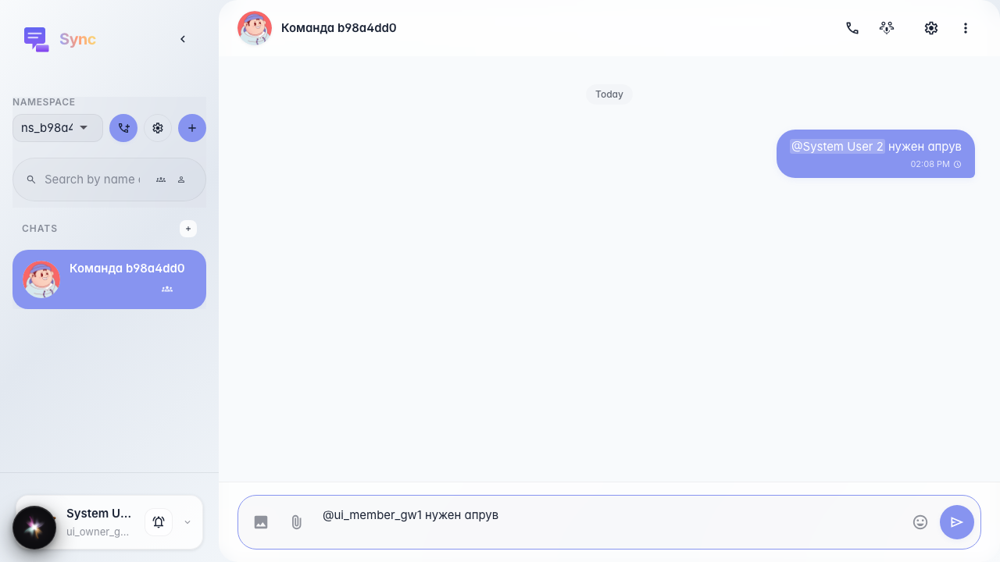

# Sync: @ mention in a channel

A channel is created and a second company member is added via API. After «@» in the composer a member list opens; selecting one inserts @user_id; the bubble shows the name from company members, not the raw id.

## Step 1. Channel with two members opened

## Step 2. Popup with member list

## Step 3. Member selected, text appended

## Step 4. Message with mention in the feed

