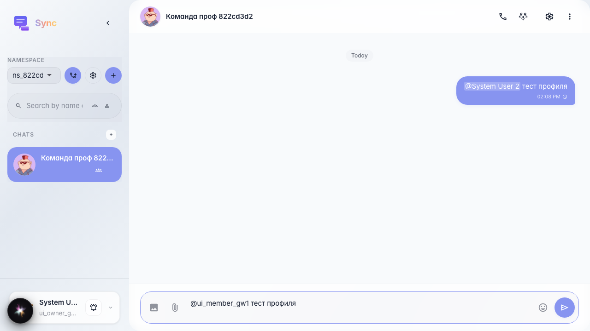
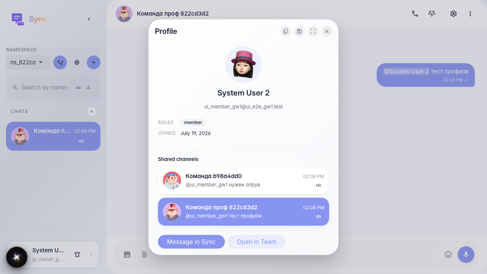
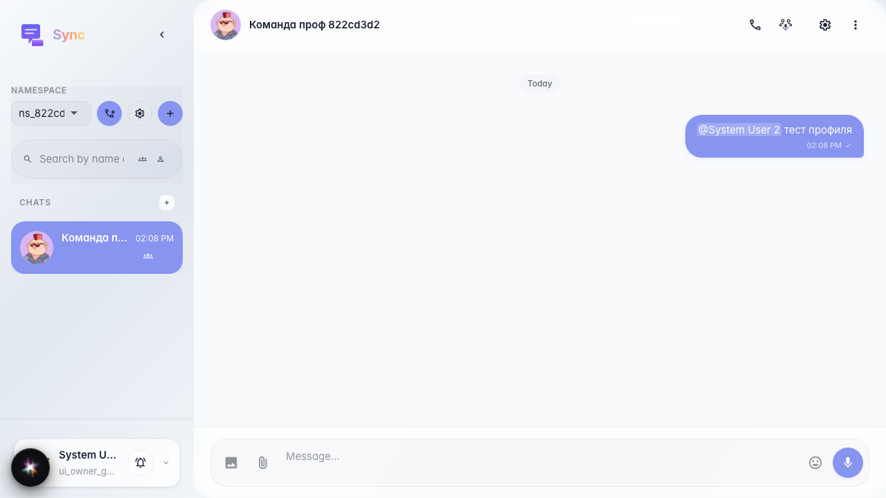

# Sync: click @mention opens profile card

After sending a message with a mention, clicking the highlighted name opens the profile card; the name and shared channels block are visible; the grid shows a channel row like in the sidebar.

## Step 1. Mention in the feed

## Step 2. Profile modal: shared channel in the grid

## Step 3. Navigate to channel from profile card

