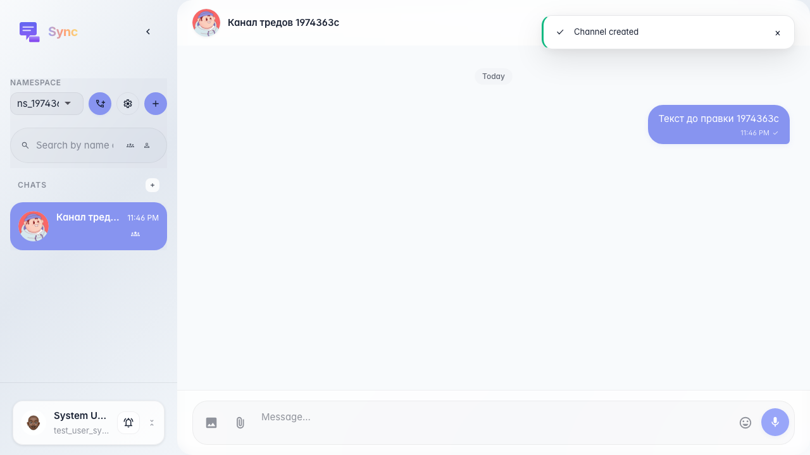
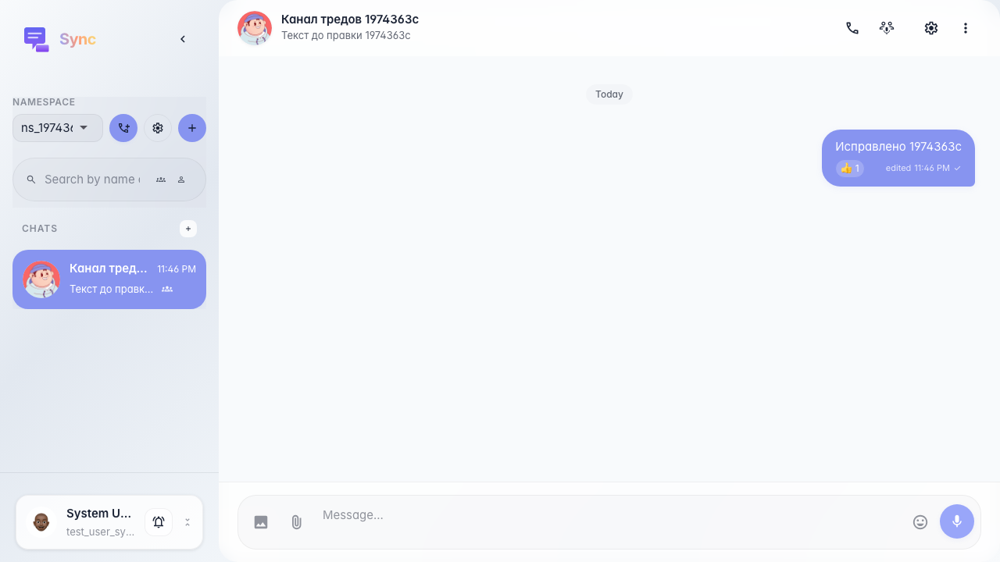

# Sync: react to and edit your own message

A message is sent from the UI; a reaction is added via API; after reload the reaction badge is visible; text editing is done in the UI.

## Step 1. Message sent

## Step 2. Reaction added

## Step 3. Message text changed

