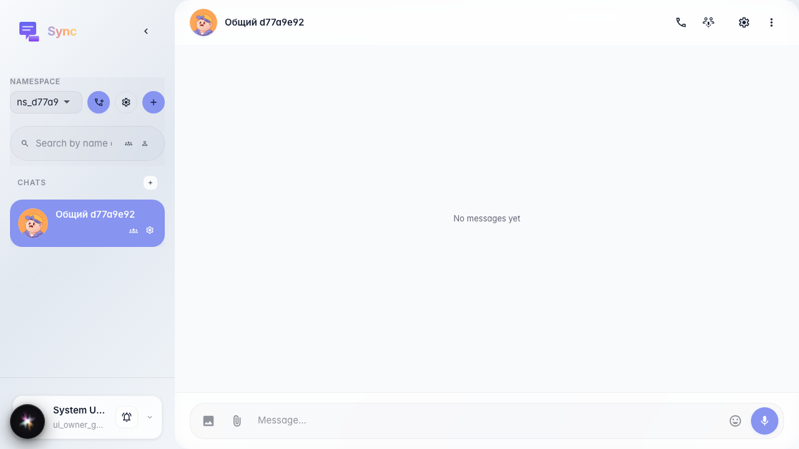
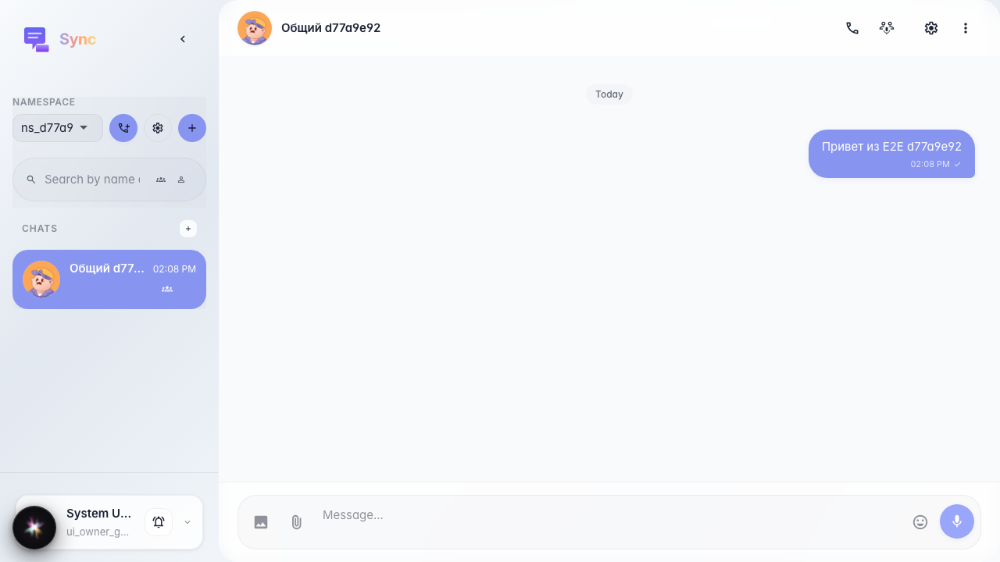

# Sync: send a message in a channel

The user opens a channel, types text in the «Message…» field, and sends it; the text appears in the feed.

## Step 1. Channel selected, chat opened

## Step 2. Message appears in the feed

