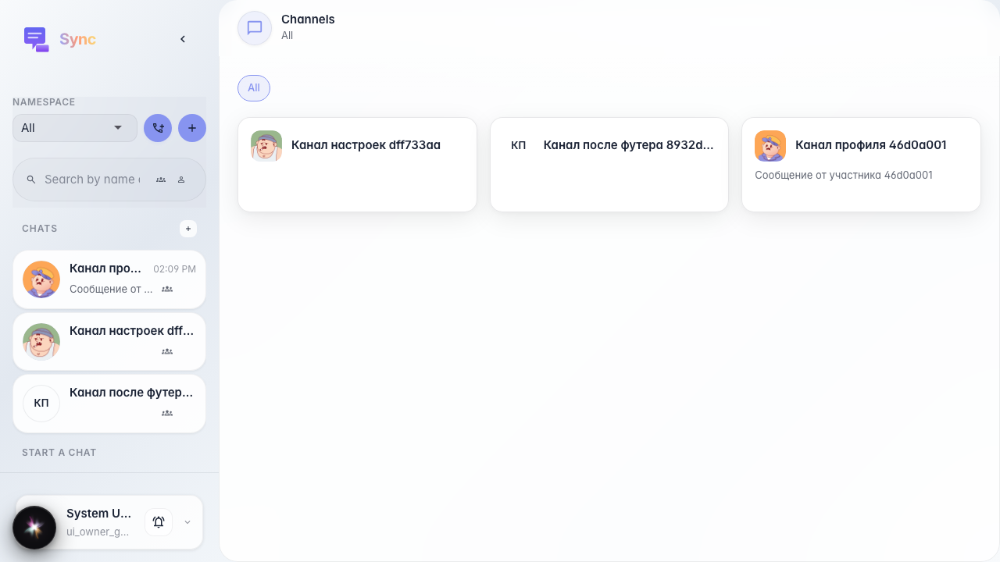
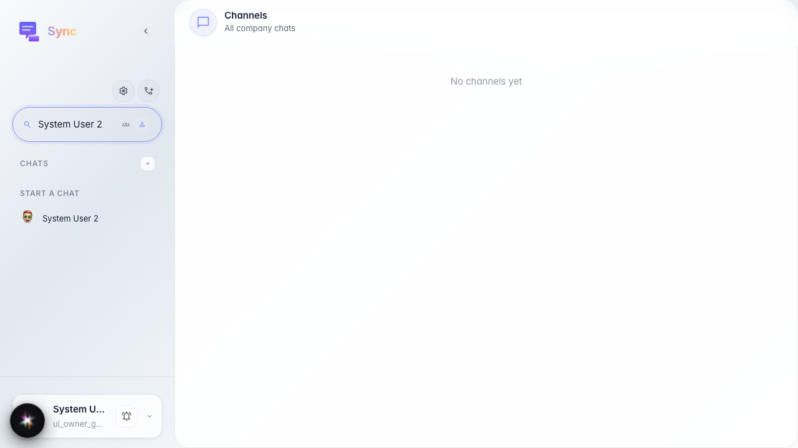
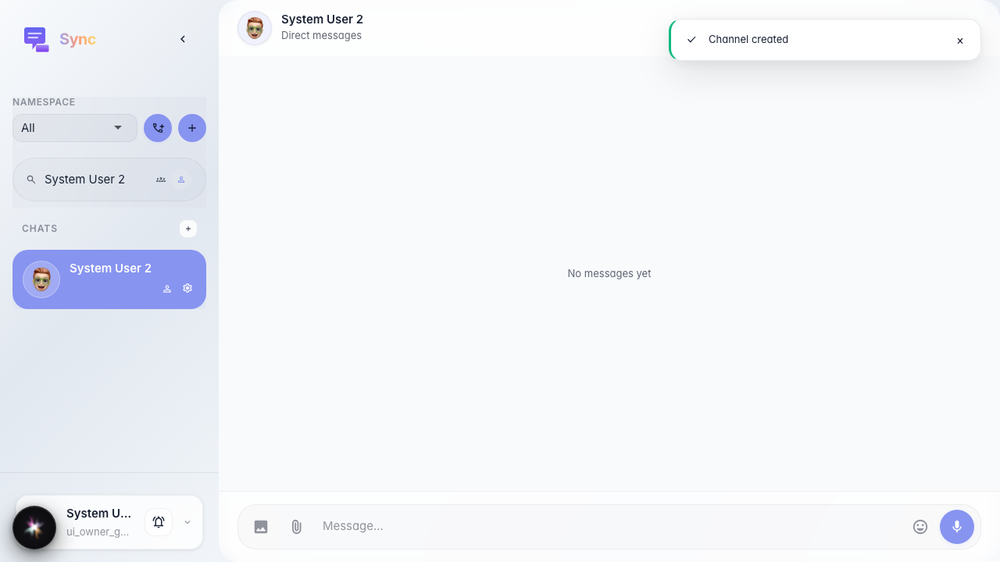

# Sync: open a chat with a company member

In the «Direct» section the user finds a colleague by name and opens a conversation with them.

## Step 1. Sync opened, Direct section is available

## Step 2. Search by member name

## Step 3. Chat opened with the selected member

