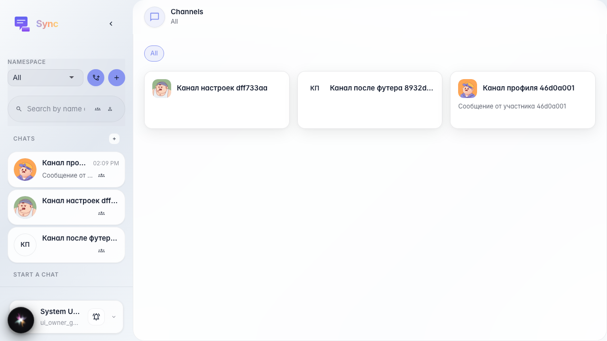
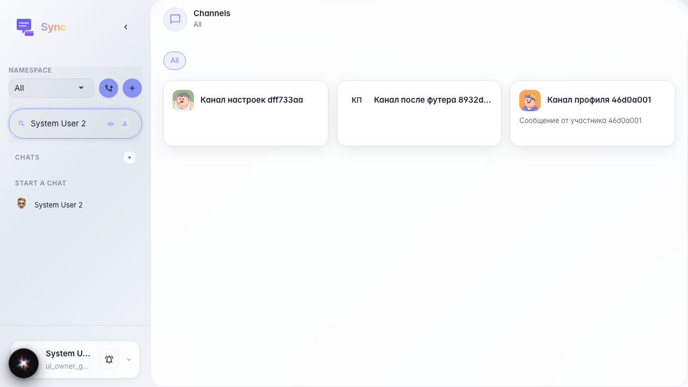
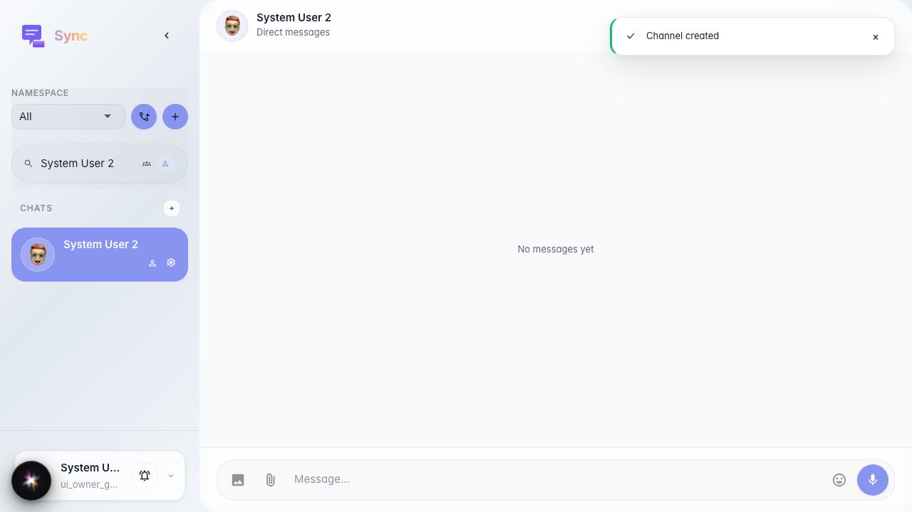

# Sync: открытие чата с участником компании

В разделе «Личные» пользователь находит коллегу по имени и открывает с ним диалог.

## Шаг 1. Sync открыт, раздел «Личные» доступен

## Шаг 2. Поиск по имени участника

## Шаг 3. Открыт чат с выбранным участником

