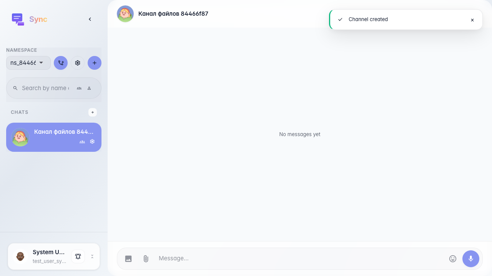
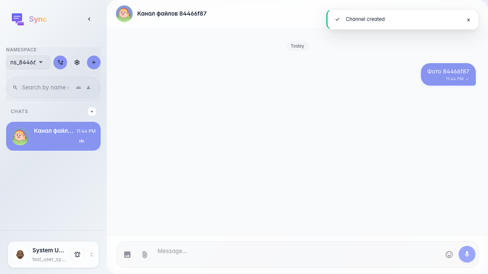

# Sync: send a message with an image

The user attaches an image to a message; after sending, the feed shows a block with the picture.

## Step 1. Channel opened

## Step 2. Message with image preview in the feed

