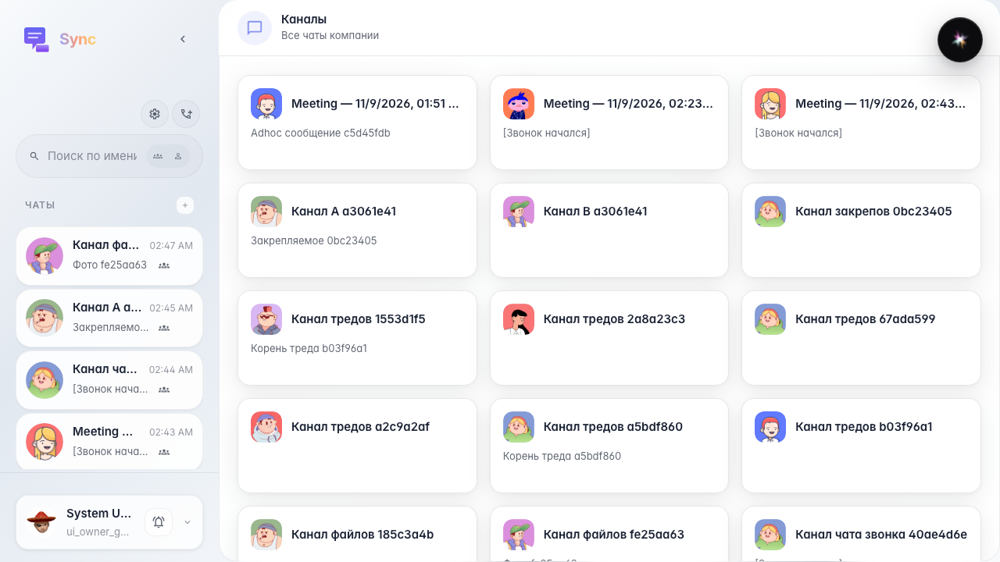
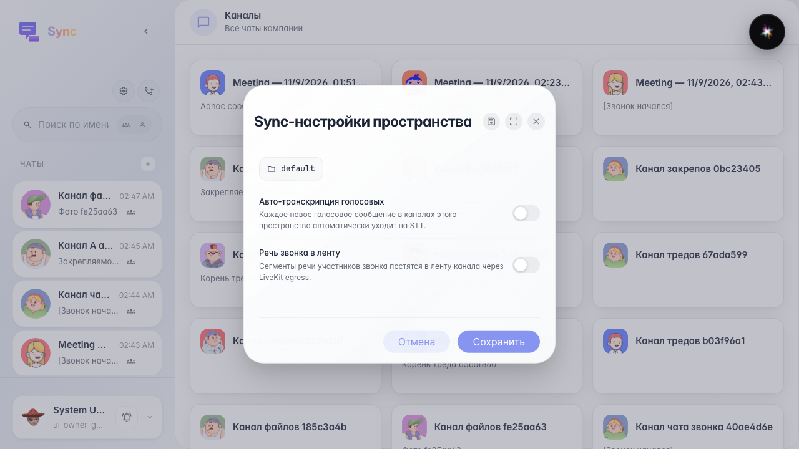
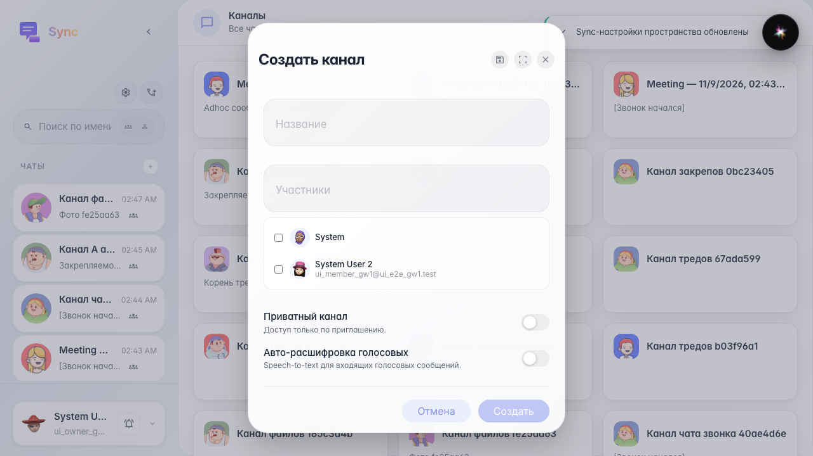
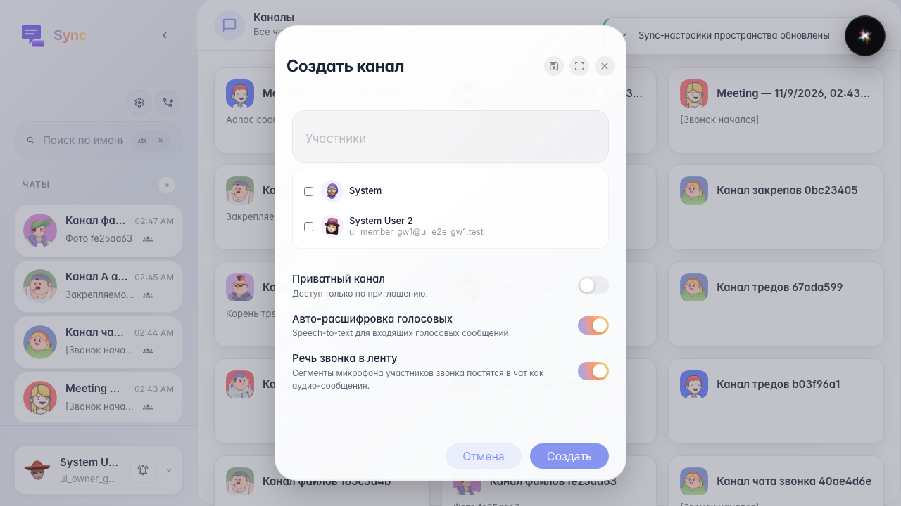
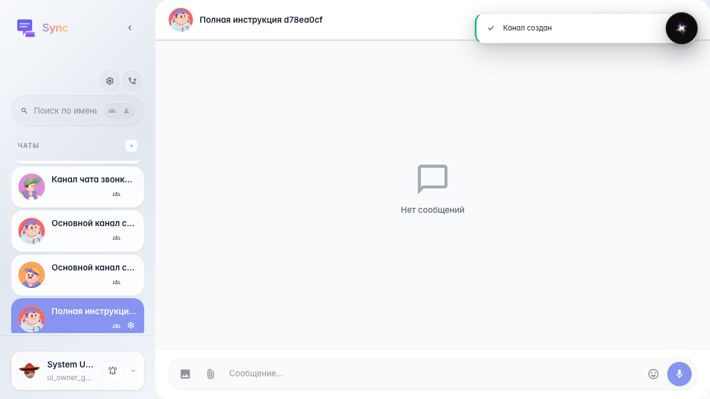
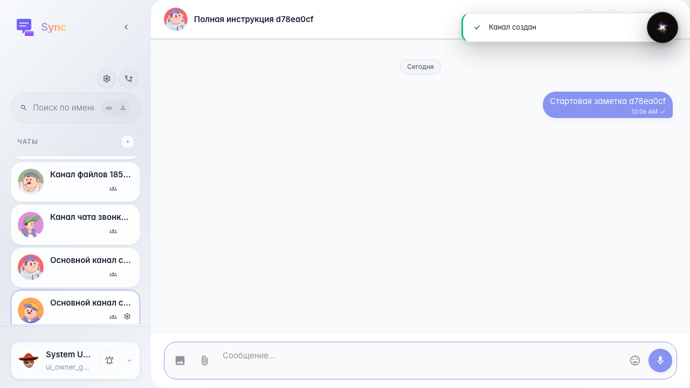
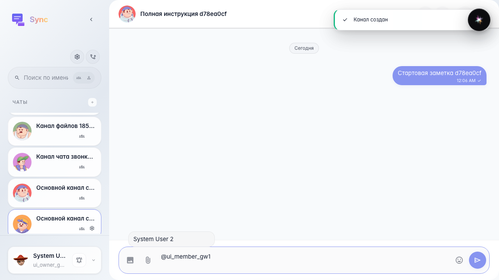
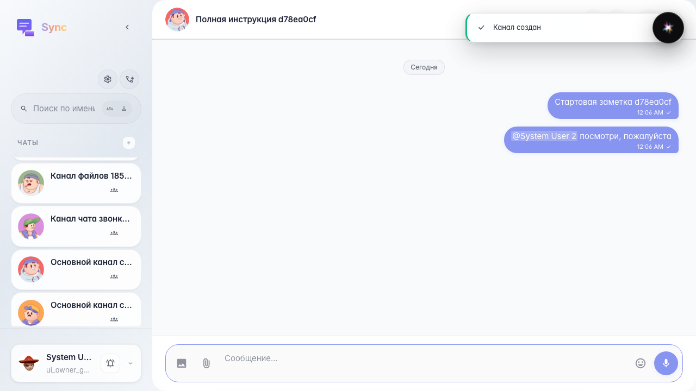
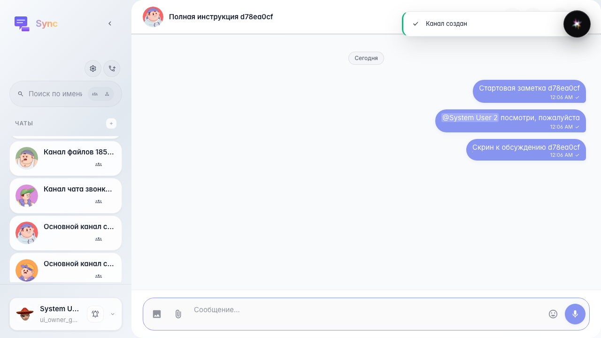

# Sync: complete service guide

A long walkthrough of the main Sync workflow: space, channel, messages, mentions, attachments, message menu, pins, threads, channel settings, member profile, and real realtime updates.

## Step 1. Sync opened with the company chat list

On the first screen, check three interface areas:

- on the left are the chat list, search, and search scope switch;
- above the list are the Sync settings gear and the meeting button;
- in the center are channel cards you have access to.

Sync has no namespace switcher: you see all chats by membership. Transcription defaults live on the company workspace ``default``.

## Step 2. Company Sync defaults opened

The gear in the chat list header opens Sync settings for the company workspace ``default`` (it does not create or switch namespaces).

- «Auto-transcribe voice messages» enables STT for new voice messages in company channels by default.
- «Speech from calls into the feed» publishes speech segments from call participants into the channel feed when the backend and LiveKit egress are configured.

These values act as company defaults; a specific channel can override them in channel settings.

## Step 3. Channel creation form opened

A channel is the main working unit in Sync. The form includes:

- «Name» — the human-readable channel name in the sidebar and cards;
- «Members» — colleagues you can add to the channel right away;
- «Private channel» — access only for invited users;
- «Auto-transcribe voice messages» — STT for voice messages in this channel;
- «Speech from calls into the feed» — publish speech from calls directly into the chat.

If flags are enabled on both the space and the channel, the final channel behavior is visible to the user without calling the API.

## Step 4. Channel name and options filled in

Before creating a channel it helps to enable the needed flags right away. That way the team will not hunt for these settings after the first call or after the first voice message.

## Step 5. Channel created and opened

An open channel consists of a header, feed, and composer.

- The header shows the avatar, name, subtitle, call, video, settings buttons, and a menu of extra actions.
- The feed shows messages, dates, delivery status, reactions, and pins.
- The composer at the bottom sends text, files, voice messages, mentions, and thread replies.

## Step 6. First message sent

A text message goes through a Sync realtime command and appears in the feed right away. For the user it is a normal chat, but technically the event also updates the channel preview, last message date, and unread state for other members.

## Step 7. Mention popup opened

A mention starts with `@`. The popup searches company members, and after selection inserts the technical user_id. In the feed the user sees a normal name because Sync resolves the id through the company member list.

Mentions matter beyond visuals: the backend validates the channel member and sends a separate mention notification.

## Step 8. Message with mention appeared in the feed

After sending, the mention looks like a person's name, not `@user_id`. Clicking that name opens the profile card and shared channels.

## Step 9. Message with image sent

The attachment button uploads the file to the file backend and adds it to the message as a content block. Sync shows a preview for images and a file row with download for documents. The message caption remains a normal text block.

