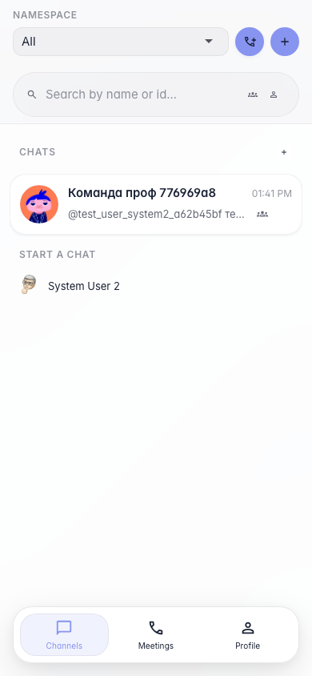

# Sync: mobile chat list

At a phone-like viewport width Sync shows the chat list directly on the main screen without an extra sidebar expand step.

## Step 1. Sync on a narrow viewport

## Step 2. Chat list is available without an extra click

