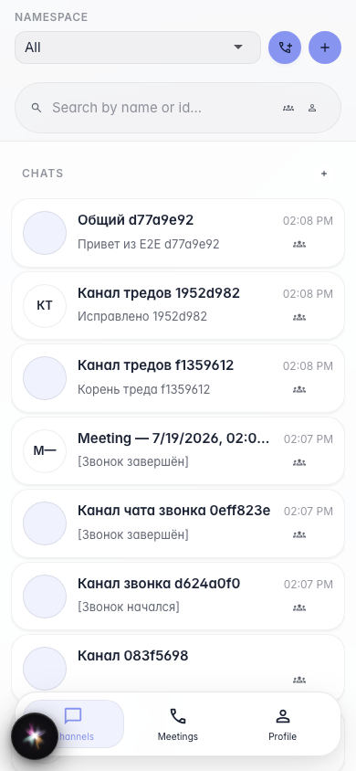
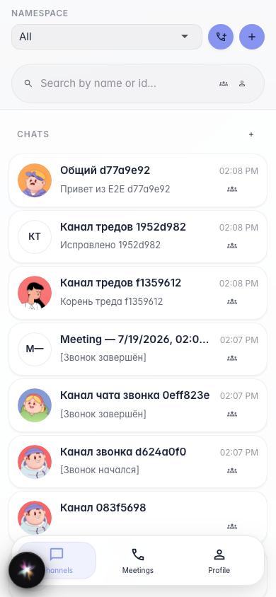

# Sync: мобильный список чатов

При ширине viewport как на телефоне Sync показывает список чатов прямо на главном экране, без дополнительного раскрытия сайдбара.

## Шаг 1. Sync на узком viewport

## Шаг 2. Список чатов доступен без лишнего клика

