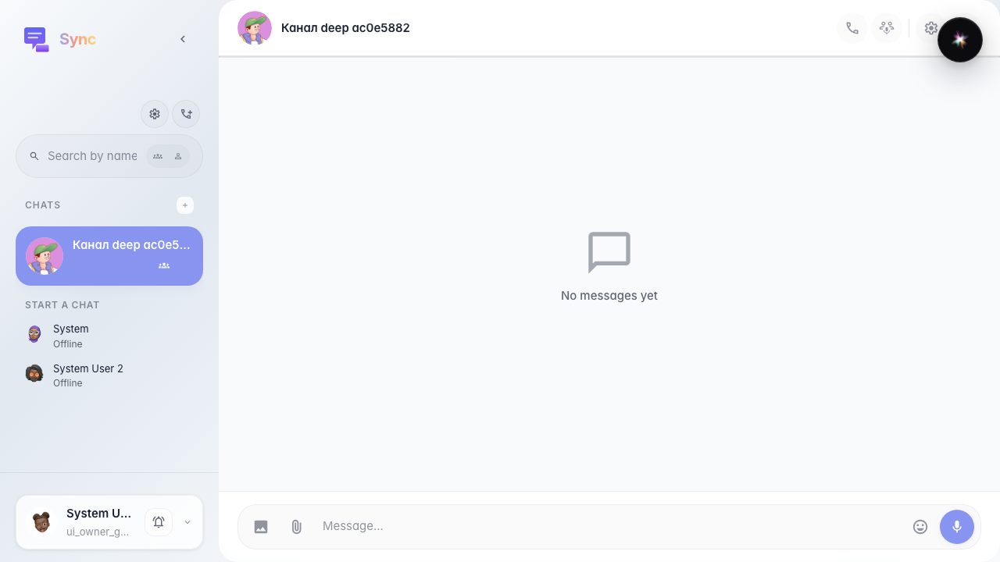
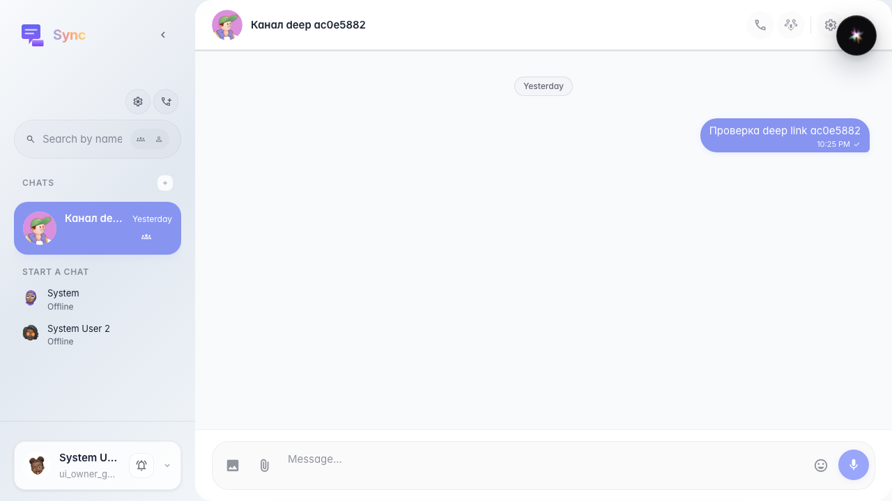

# Sync: open a channel via direct link

After creating a channel in the UI the test fetches the channel id via API and opens Sync at `/sync/c/{channel_id}` — the selected channel and chat load automatically.

## Step 1. Sync reopened via direct channel link

## Step 2. Message goes to the channel selected from the URL

