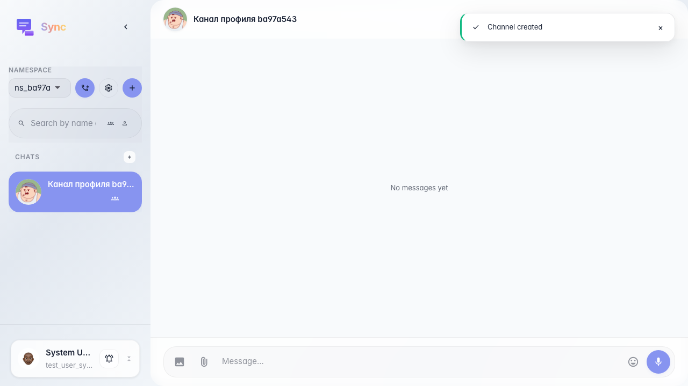
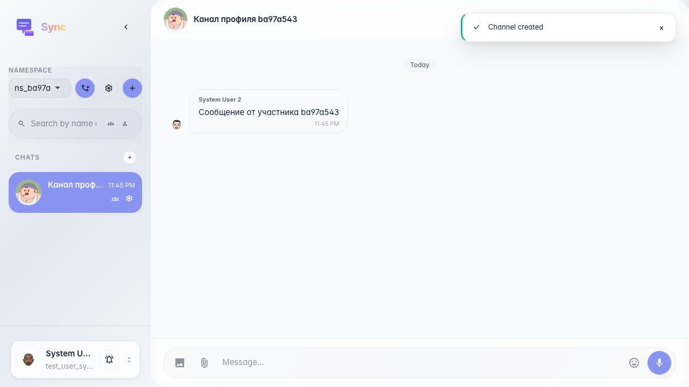

# Sync: sender profile from a message

A member is added to the channel; their message is created via API; the owner opens the profile by clicking the avatar on someone else's message bubble.

## Step 1. Second member added to the channel

## Step 2. Message from the second member sent via API

