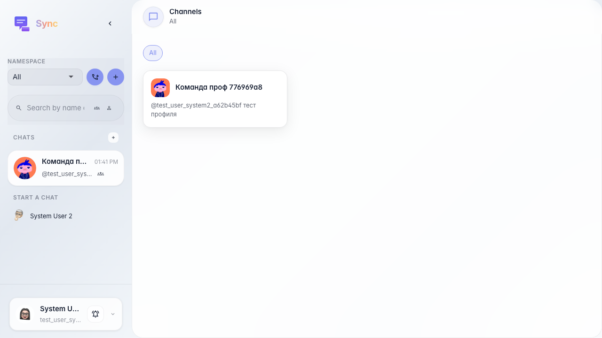
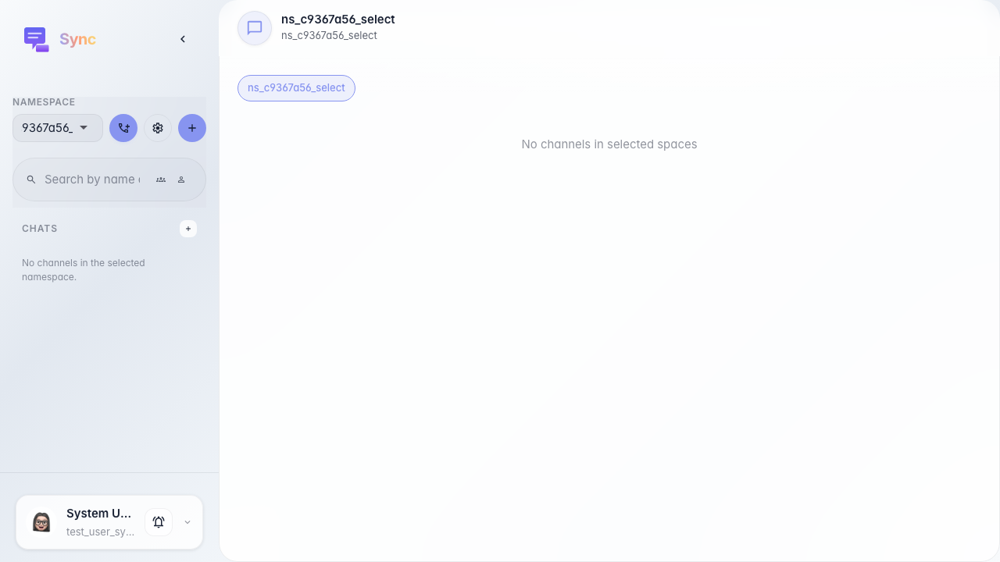

# Sync: выбор пространства

Пользователь открывает Sync и выбирает существующее платформенное пространство в селекторе сайдбара.

## Шаг 1. Открыт Sync со списком всех пространств

## Шаг 2. Пространство выбрано в сайдбаре

