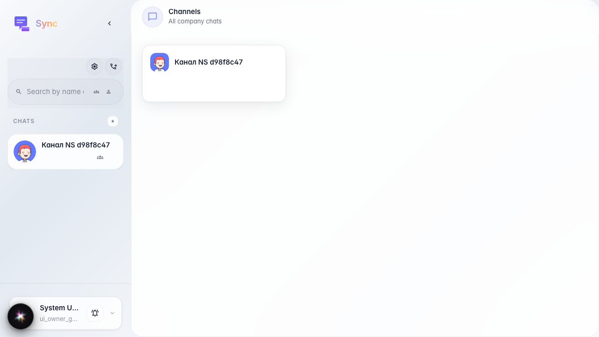
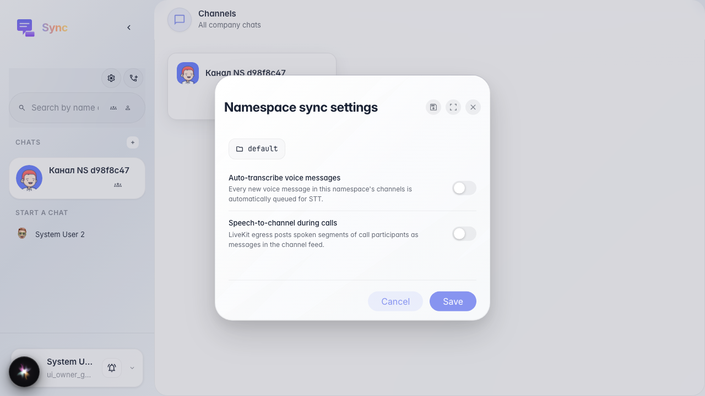
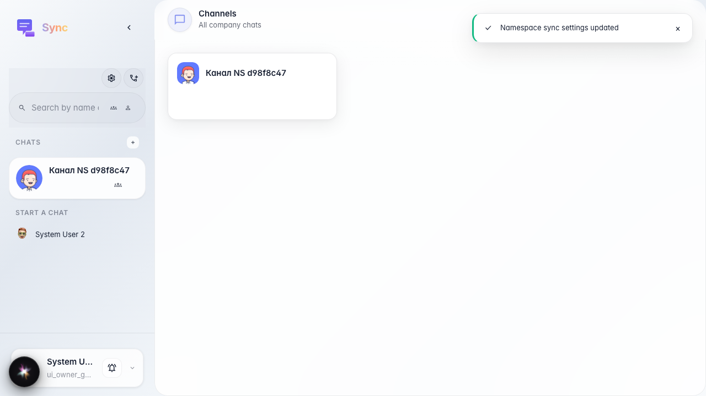

# Sync: transcription defaults

The user opens company Sync defaults (workspace default) and enables voice message transcription.

## Step 1. Sync opened

## Step 2. Company Sync defaults opened

## Step 3. Sync defaults saved

