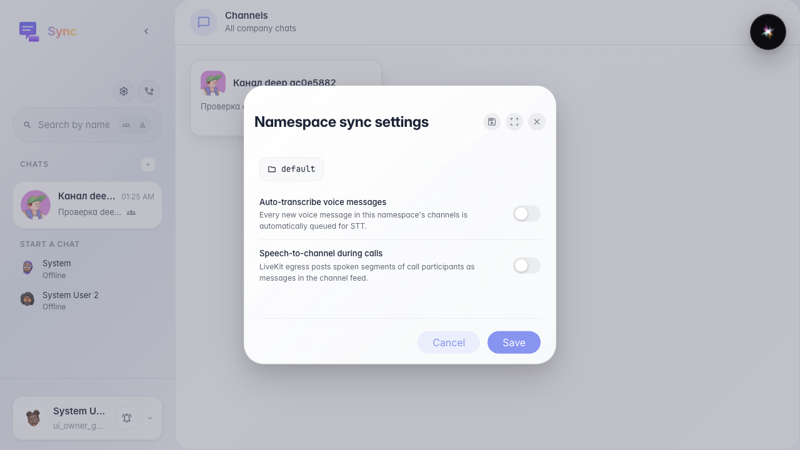

# Sync: настройки транскрипции

Пользователь открывает Sync-настройки компании (workspace default) и включает опцию транскрибации голосовых сообщений.

## Шаг 1. Sync открыт

## Шаг 2. Открыты настройки Sync компании

## Шаг 3. Настройки Sync сохранены

