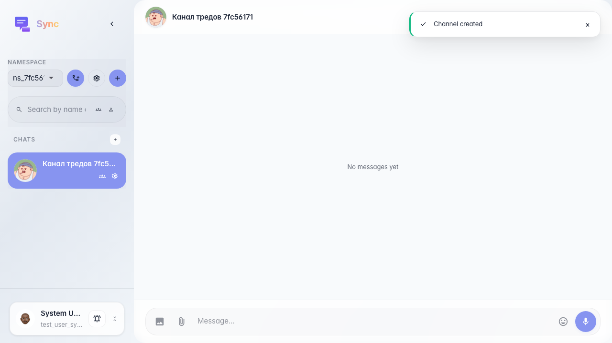
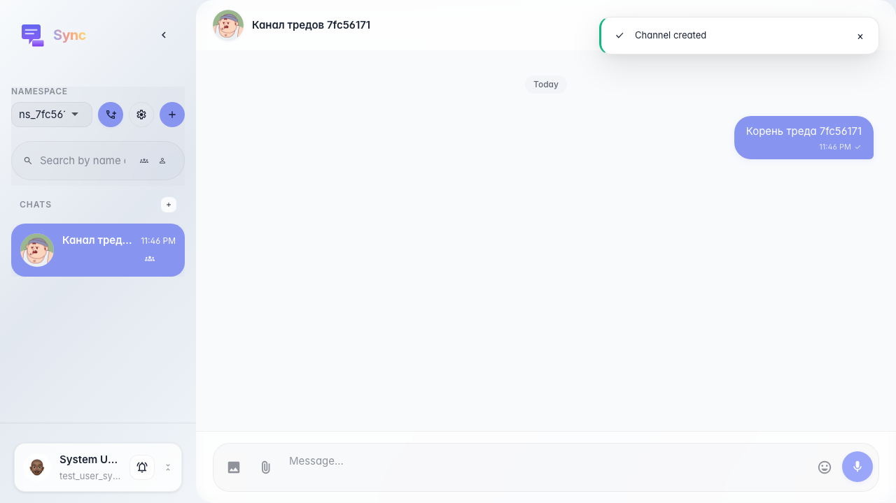
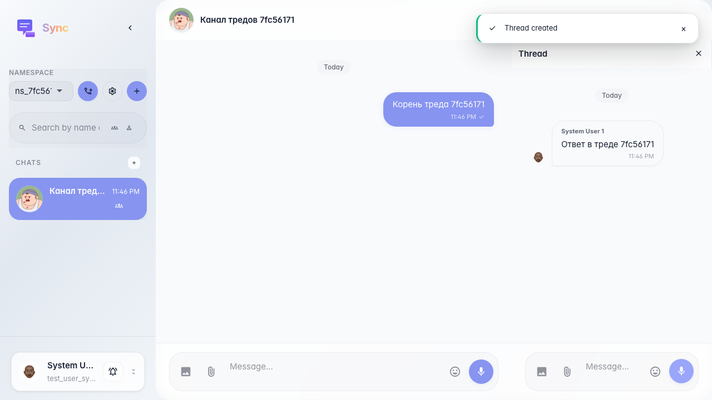

# Sync: threads panel after replying to a message

The user replies to a message in the main feed and opens the «Threads» panel: the header and list area are displayed (the list may be empty if thread_id is not yet set on feed messages).

## Step 1. Space and channel created

## Step 2. Root message sent

## Step 3. Thread opened and reply sent

## Step 4. Threads panel opened

