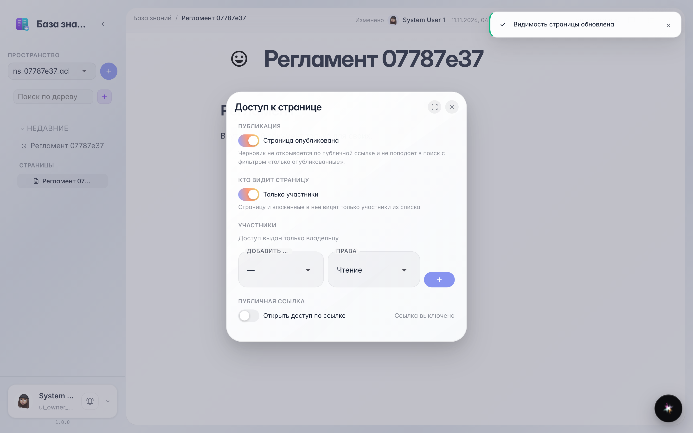
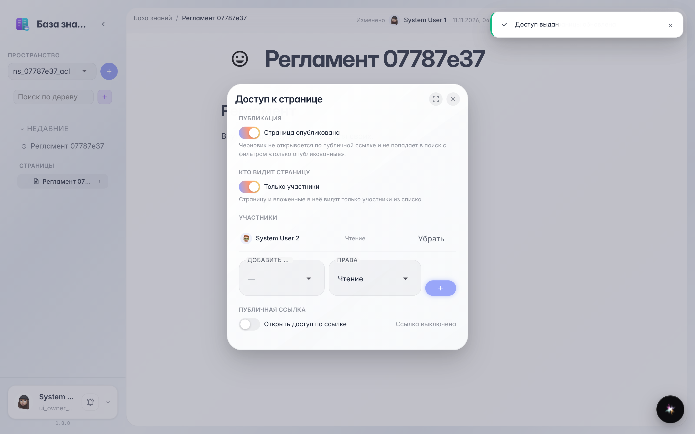
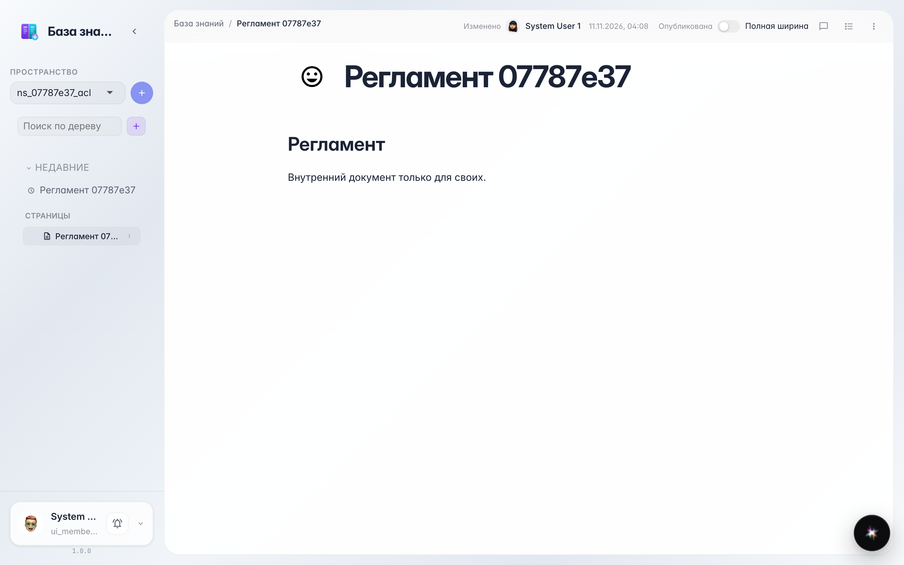

# Wiki: page access and member roles

**Purpose:** any page can be closed from the whole company and opened only to selected people — with «Viewer» or «Editor» role.

**Problems solved:** an internal policy or draft should not be visible to the whole office — show it only to those who need it.

**Result:** the page is restricted, a member is added as viewer and opens it on their side.

## Step 1. Page restricted — members list appeared

In the «Access» dialog turn on «Members only»: the page is no longer visible to the whole company — only to the owner and people on the list.

## Step 2. Member added with «Viewer» role

In «Add member» pick a colleague and a role: «Viewer» — read only, «Editor» — can edit. The colleague appears in the list with their role.

## Step 3. Viewer opened the page

The member opens the same page in their knowledge base and reads the document — the rest of the company cannot see it.

**Summary.** A restricted page is only available to selected people with the right role.

