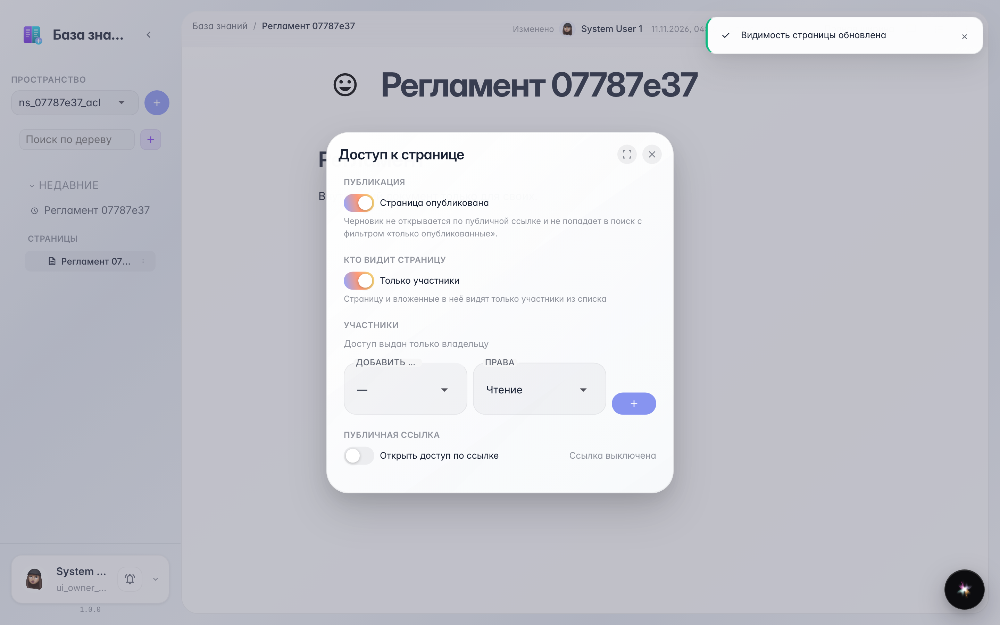
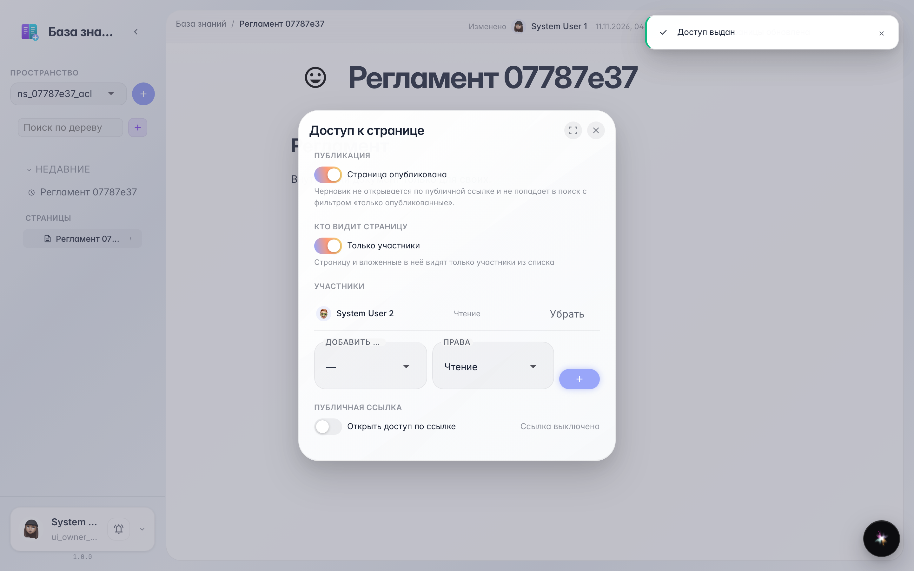
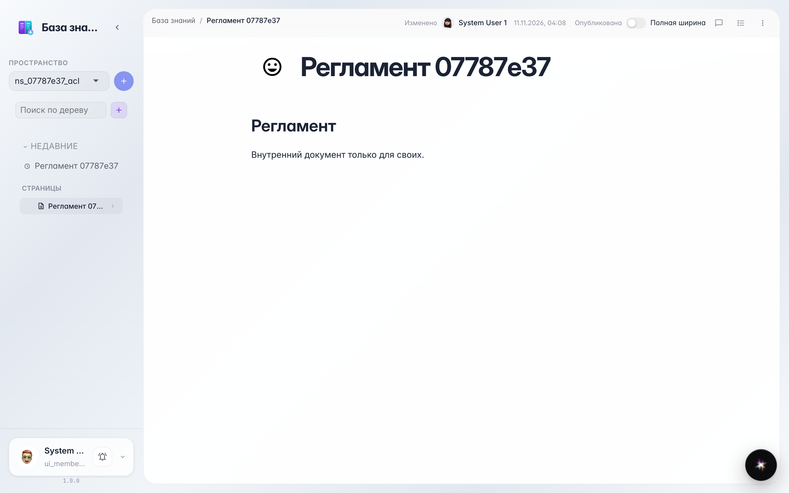

# Wiki: доступ к странице и роли участников

**Для чего:** любую страницу можно закрыть от всей компании и открыть только выбранным людям — с ролью «Читатель» или «Редактор».

**Какие проблемы решает:** внутренний регламент или черновик не должен видеть весь офис — показываем его только тем, кому нужно.

**Результат:** страница ограничена, участник добавлен читателем и открывает её у себя.

## Шаг 1. Страница ограничена — появился список участников

В окне «Доступ» включаем «Только участники»: теперь страницу не видит вся компания — только владелец и люди из списка.

## Шаг 2. Участник добавлен с ролью «Читатель»

В строке «Добавить участника» выбираем коллегу и роль: «Читатель» — только читает, «Редактор» — может править. Коллега появляется в списке со своей ролью.

## Шаг 3. Читатель открыл страницу

Участник открывает ту же страницу в своей базе знаний и читает документ — остальная компания его не видит.

**Итог.** Ограниченная страница доступна только выбранным людям с нужной ролью.

