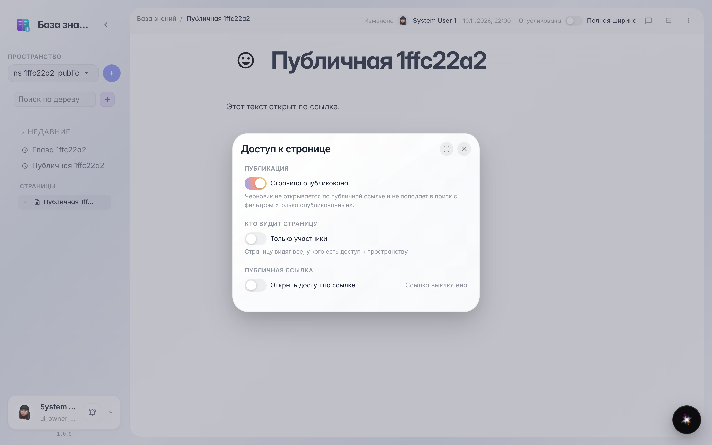
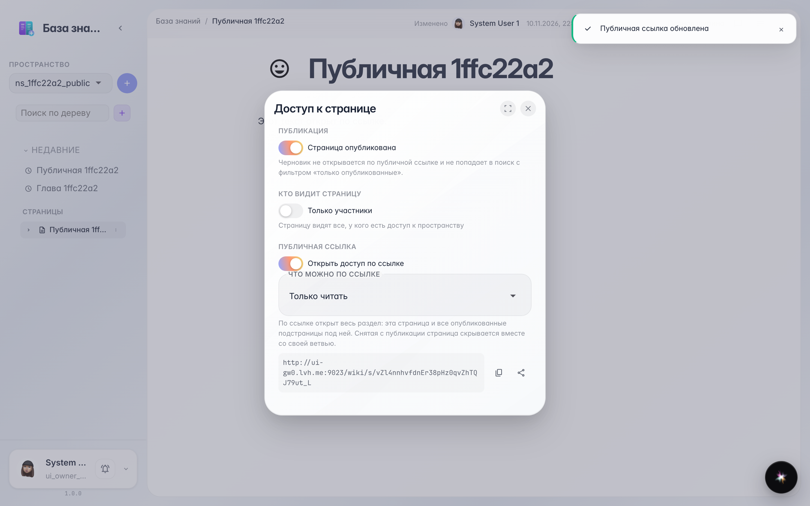
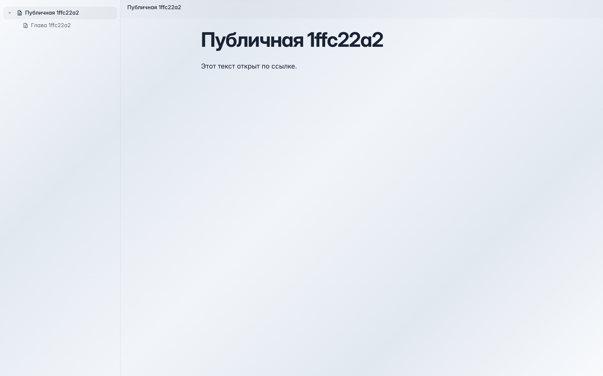
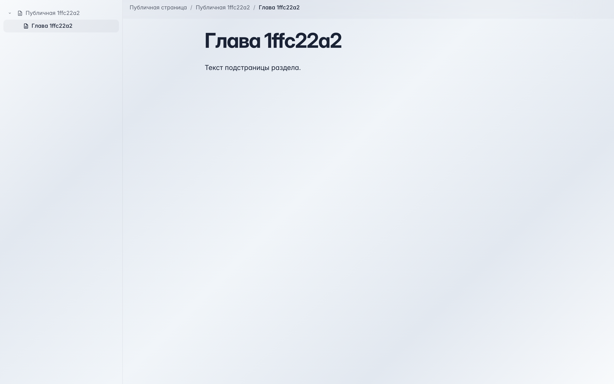

# Wiki: публичная ссылка на раздел

Включение публичной ссылки и чтение раздела с подстраницами без входа в систему.

## Шаг 1. Открыто окно доступа

## Шаг 2. Публичная ссылка включена

## Шаг 3. Раздел открыт без входа в систему

## Шаг 4. Подстраница открыта по той же ссылке

