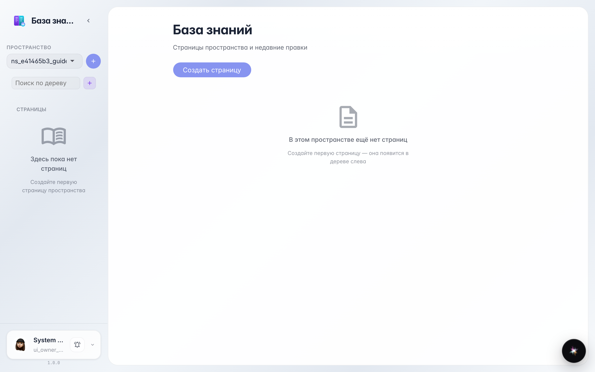
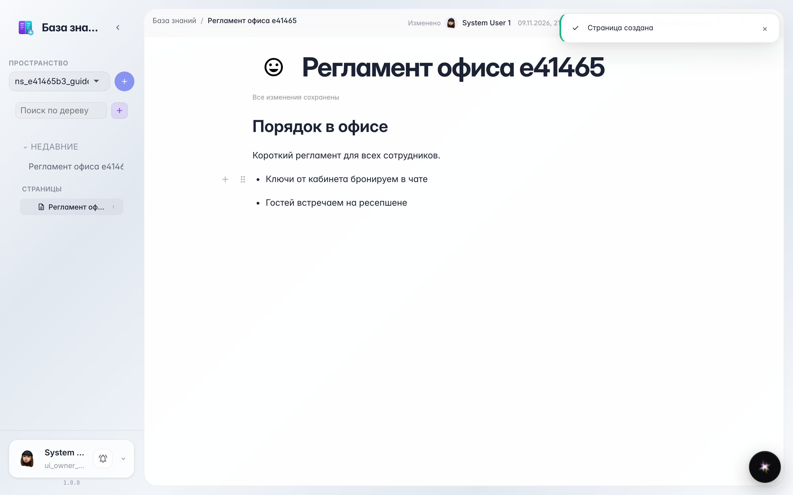

# Complete route: from empty tree to published page

**Purpose:** build a company knowledge base — walk the full route from an empty tree to a page visible to the whole company.

**Problems solved:** rules and instructions scattered in chats and files. Here you will see a tidy page with headings, lists and shared access appear in a minute.

**Result:** the page is written, autosaved and opened to the whole company — colleagues can already read it.

## Step 1. Knowledge base tree

Wiki opens with a page tree: sections and nested pages on the left, content on the right. Click + near the tree to create the first page.

## Step 2. Empty page created

The new page opens right away: a title field on top, empty body below. Type a title — it appears in the tree.

## Step 3. Heading, list and autosave

Type like in a regular editor: '# ' makes a heading, '- ' a list item. No manual save needed — the indicator on top shows everything is stored.

## Step 4. Open access for the company

The page menu has an Access entry: here you see who can read and edit, and enable company-wide visibility. Turn the switch on — and the page appears for colleagues.

