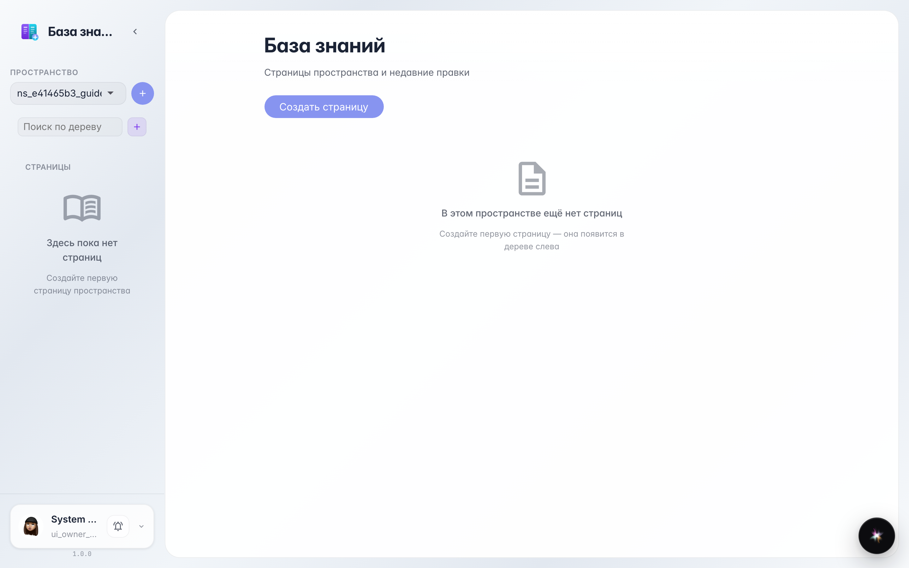
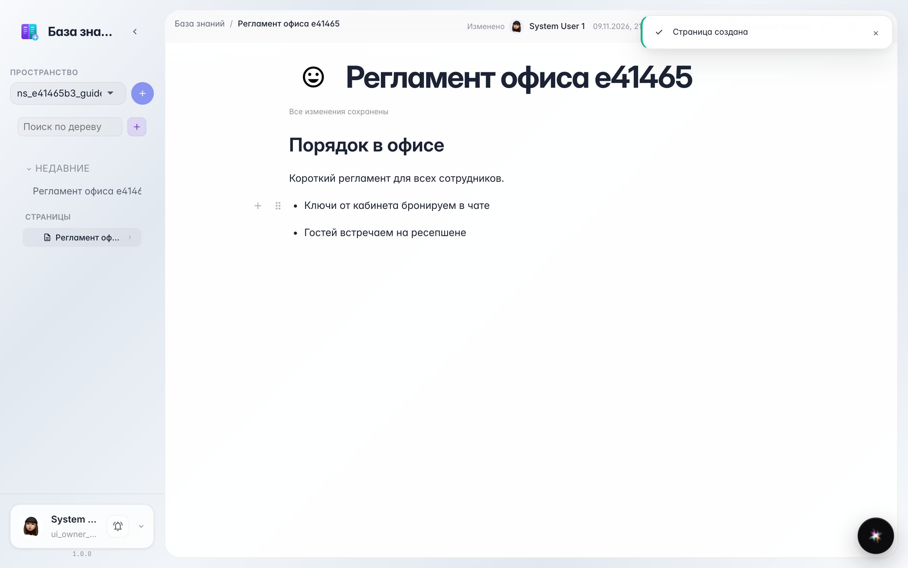

# Полный маршрут: от пустого дерева до опубликованной страницы

**Для чего:** завести корпоративную базу знаний — пройти весь путь от пустого дерева до страницы, видимой всей компании.

**Какие проблемы решает:** регламенты и инструкции лежат в чатах и файлах. Здесь вы увидите, как за минуту появляется аккуратная страница с заголовками, списками и общим доступом.

**Результат:** страница написана, автосохранена и открыта для всей компании — коллеги уже могут её читать.

## Шаг 1. Дерево базы знаний

Wiki открывается деревом страниц: слева — разделы и вложенные страницы, справа — текст. Нажмите «+» у дерева, чтобы создать первую страницу.

## Шаг 2. Создана пустая страница

Новая страница сразу открыта: поле заголовка сверху, пустой текст ниже. Введите название — оно появится в дереве.

## Шаг 3. Заголовок, список и автосохранение

Текст набирается как в обычном редакторе: «# » делает заголовок, «- » — пункт списка. Сохранять вручную не нужно — индикатор сверху показывает, что всё записано.

## Шаг 4. Открываем доступ для компании

В меню страницы есть пункт «Доступ»: здесь видно, кто может читать и править, и включается видимость для всей компании. Включите переключатель — и страница появится у коллег.

