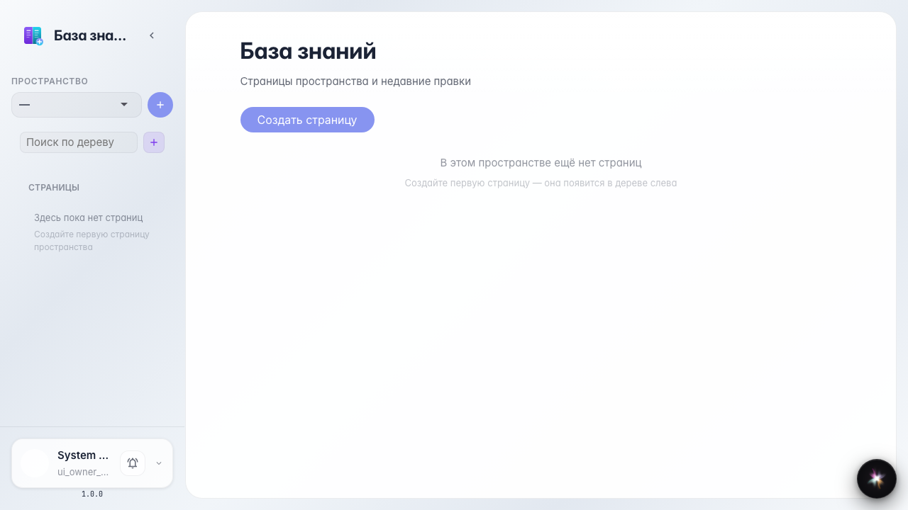
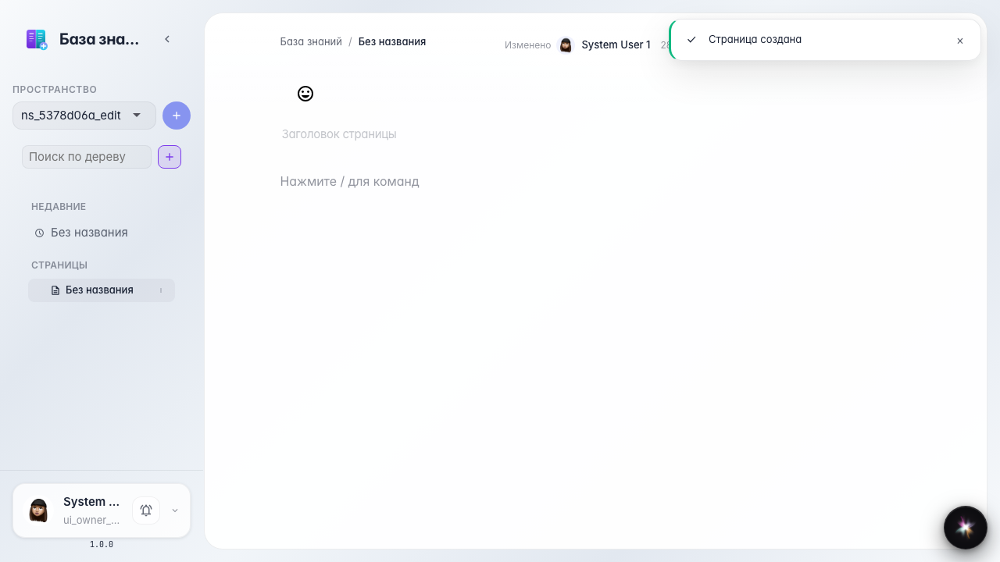
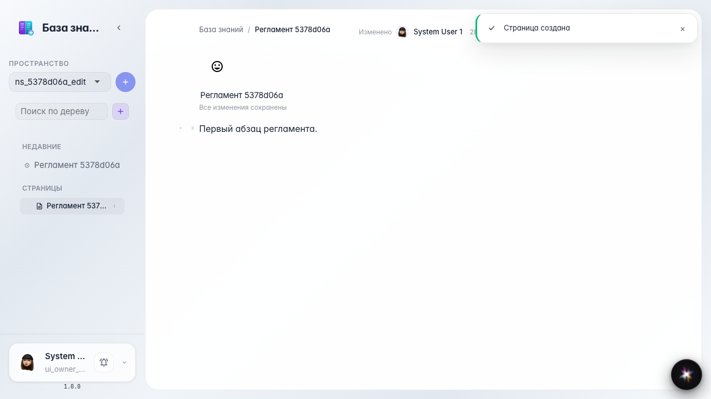

# Wiki: create and edit a page

Creating a page from the sidebar, typing a title and body, autosave.

## Step 1. Открыта база знаний

## Step 2. Создана пустая страница

## Step 3. Заголовок и текст сохранены

## Step 4. После перезагрузки содержимое на месте

