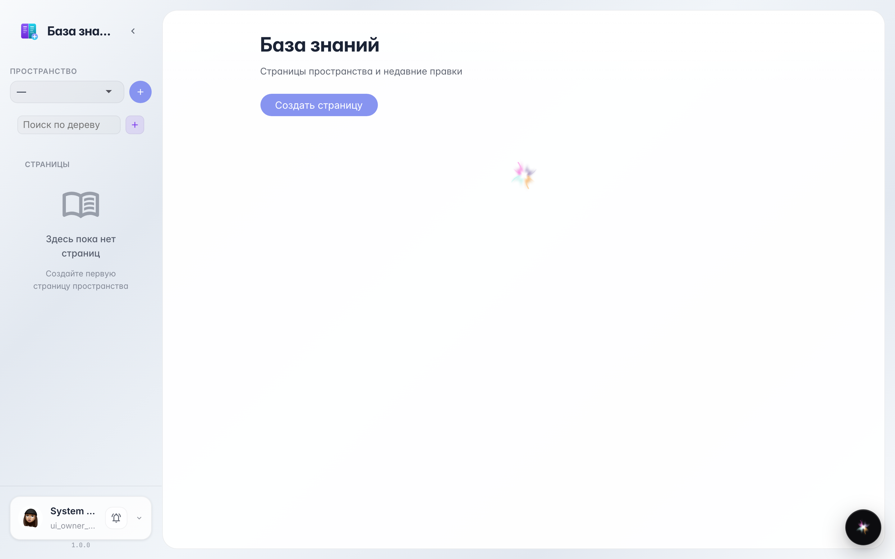
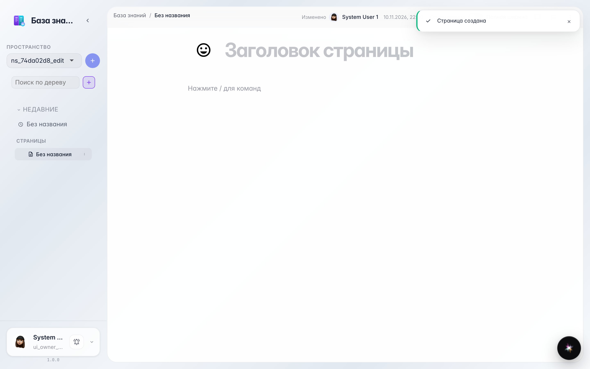
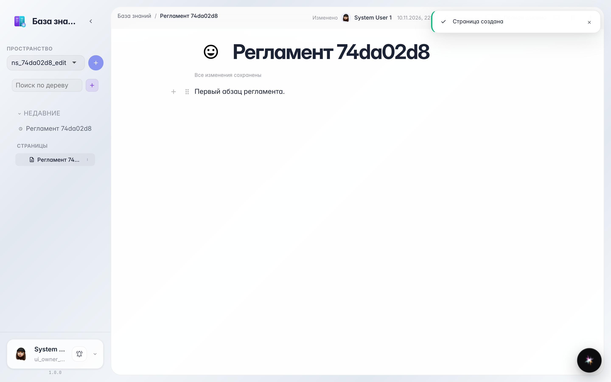
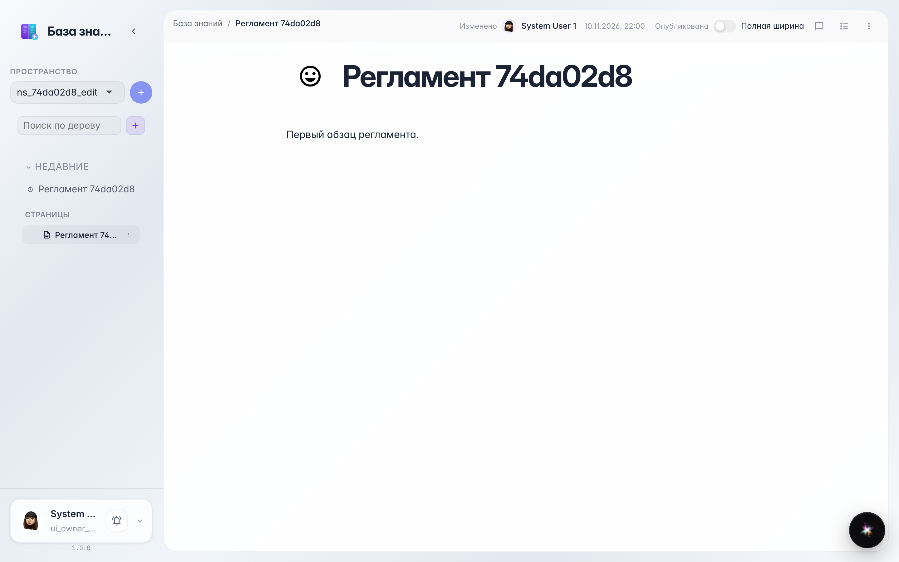

# Wiki: создание и правка страницы

Создание страницы из сайдбара, ввод заголовка и текста, автосохранение.

## Шаг 1. Открыта база знаний

## Шаг 2. Создана пустая страница

## Шаг 3. Заголовок и текст сохранены

## Шаг 4. После перезагрузки содержимое на месте

