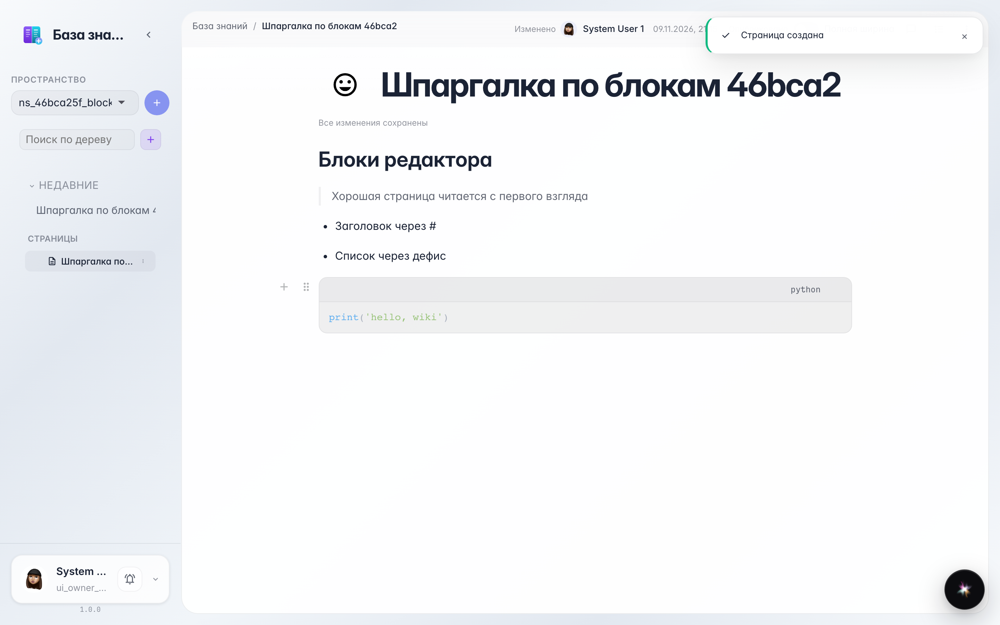

# Block editor: headings, lists, quotes and code

**Purpose:** format pages cleanly — headings, lists, quotes and code blocks without the mouse, right while typing.

**Problems solved:** a wall of text is hard to read. Short commands ('# ', '- ', '> ', '```') instantly turn a line into the right block.

**Result:** a page with a heading, to-do list, quote and code block — typed without a single toolbar click.

## Step 1. Typing blocks with short commands

The editor understands markup while typing: '# ' heading, '> ' quote, '- ' list, '```' code block. A line becomes a block right after the space.



## Step 2. Everything became blocks

Here is the same page through the reader's eyes: a big heading, a striped quote, a bullet list and highlighted code. Every block can be dragged and reordered.


