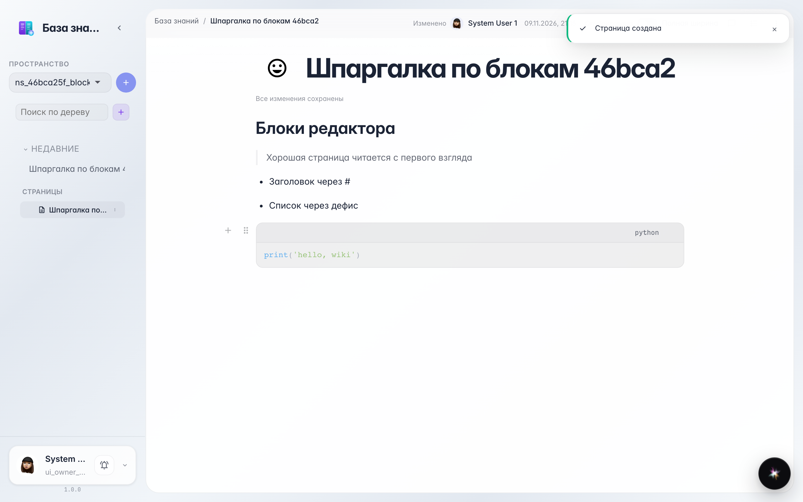

# Блочный редактор: заголовки, списки, цитаты и код

**Для чего:** оформлять страницы аккуратно — заголовки, списки, цитаты и блоки кода без мыши, прямо при наборе.

**Какие проблемы решает:** сплошной текст читается плохо. Короткие команды («# », «- », «> », «```») мгновенно превращают строку в нужный блок.

**Результат:** страница с заголовком, списком дел, цитатой и блоком кода — набранная без единого клика по панели форматов.

## Шаг 1. Набираем блоки короткими командами

Редактор понимает разметку при наборе: «# » — заголовок, «> » — цитата, «- » — список, «```» — блок кода. Строка превращается в блок сразу после пробела.



## Шаг 2. Всё превратилось в блоки

Вот та же страница глазами читателя: крупный заголовок, цитата с полосой, маркированный список и подсвеченный код. Каждый блок можно перетаскивать и менять местами.


