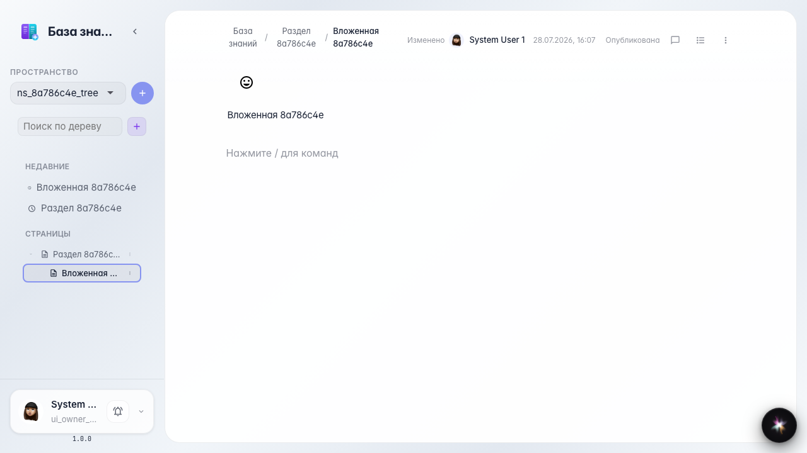

# Wiki: navigating the page tree

Expanding a section in the tree and opening a nested page.

## Step 1. Section appeared in the tree

## Step 2. Section expanded, nested page visible

## Step 3. Nested page opened

